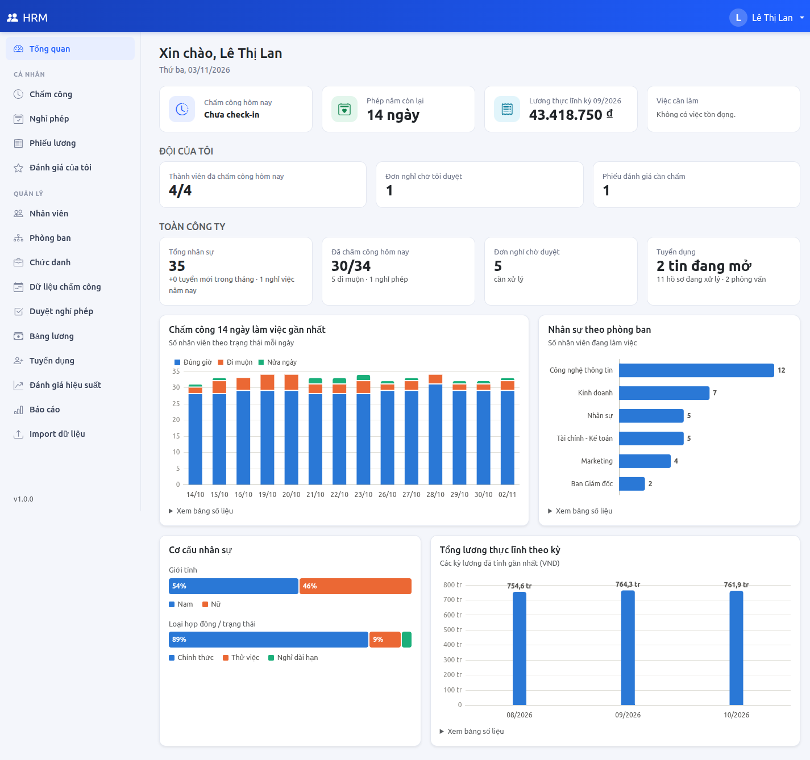
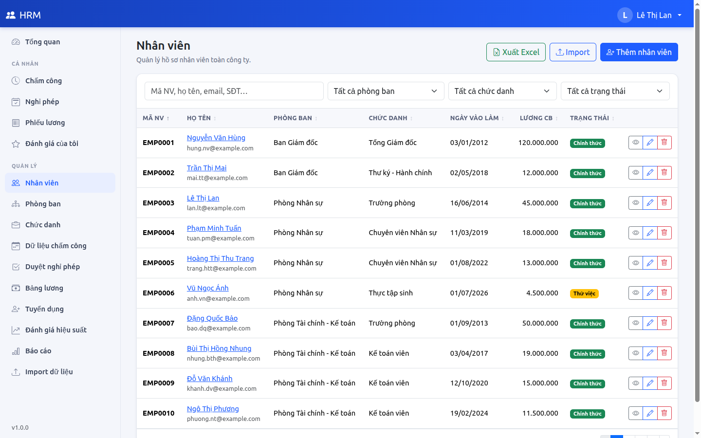
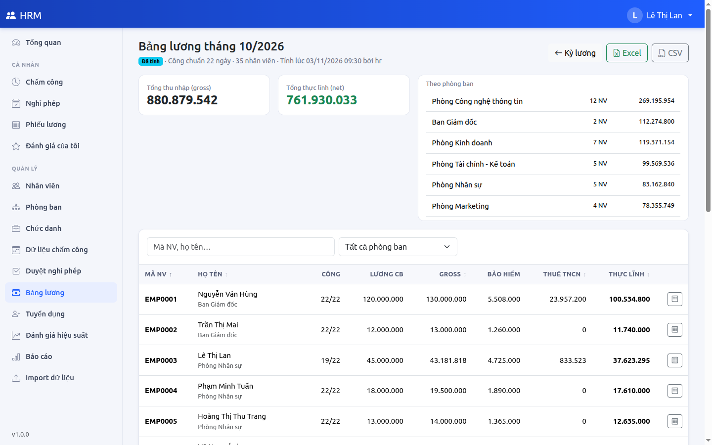
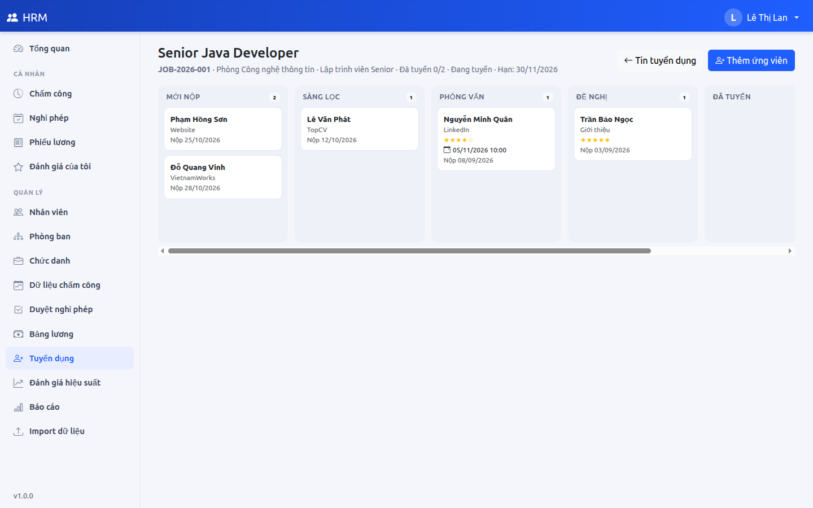
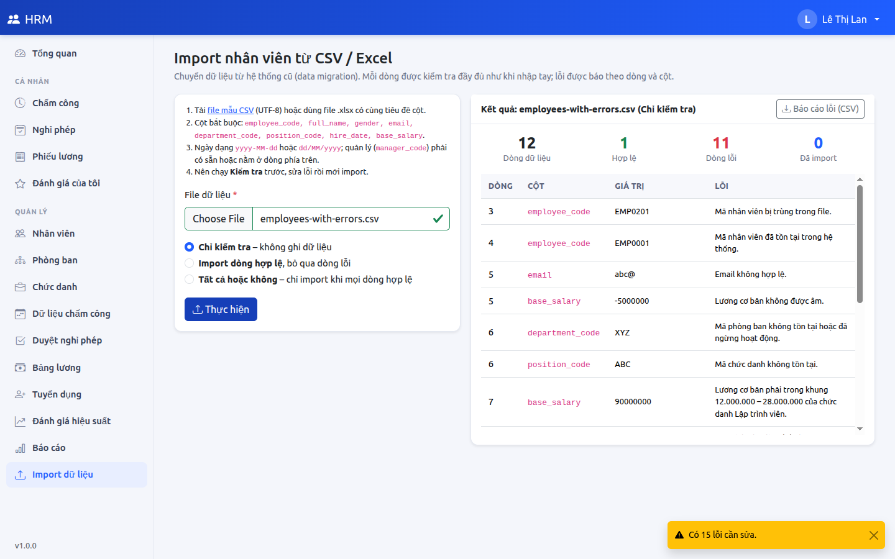
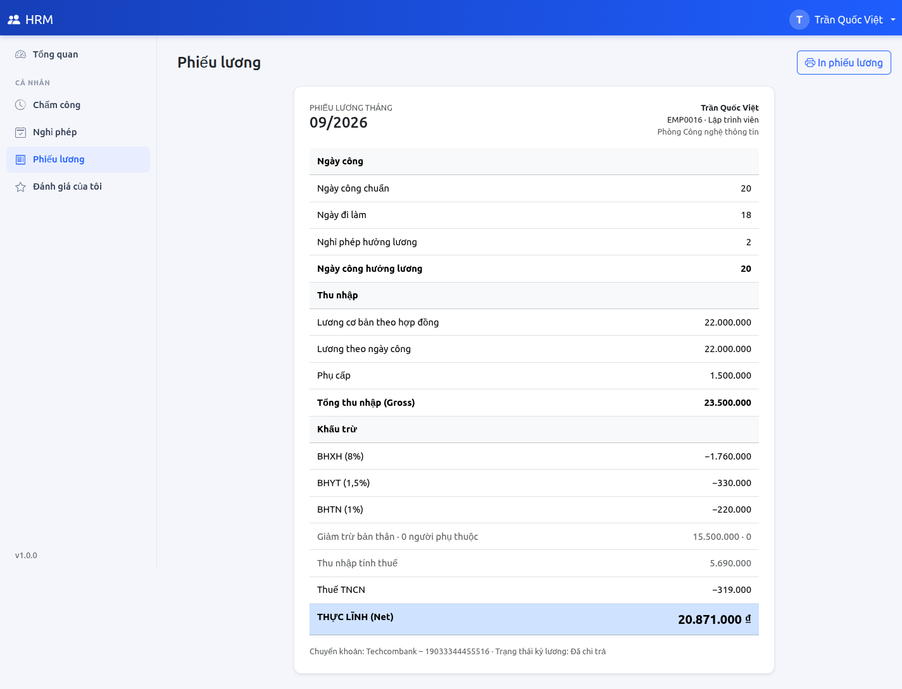
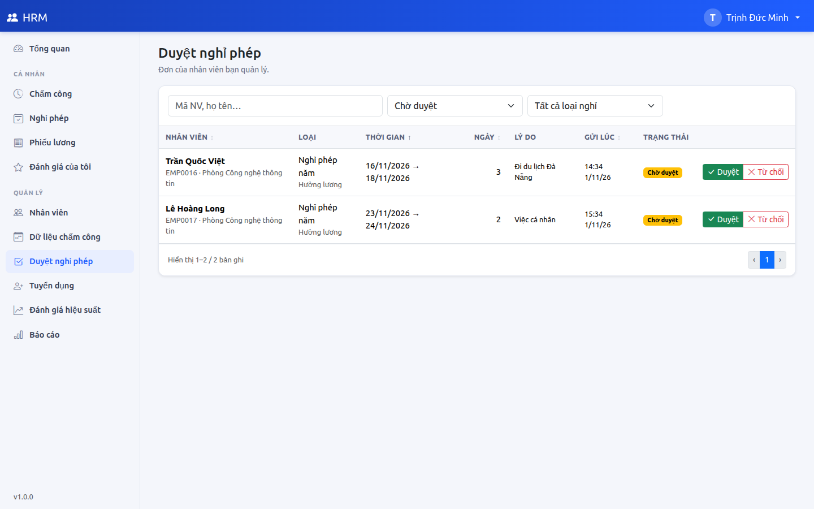
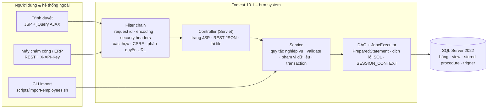

# HRM System – Hệ thống Quản lý Nhân sự

Ứng dụng web quản lý nhân sự cho doanh nghiệp Việt Nam, viết bằng **Java 17 · Servlet/JSP · JDBC · Microsoft SQL Server**:
hồ sơ nhân viên, chấm công & nghỉ phép, tính lương (BHXH, thuế TNCN lũy tiến), tuyển dụng, đánh giá hiệu suất,
báo cáo, REST API tích hợp và import dữ liệu – với phân quyền theo vai trò Admin / HR / Manager / Employee.

Không dùng framework DI/ORM: kiến trúc phân lớp viết tay (model → dao → service → controller → view) để thể hiện rõ nền tảng
Servlet, JDBC và SQL Server – từ thiết kế CSDL, stored procedure, tối ưu truy vấn tới kiểm thử, xử lý sự cố, Docker và CI.



## Mục lục

[Tính năng](#tính-năng) · [Ảnh màn hình](#ảnh-màn-hình) · [Công nghệ](#công-nghệ) · [Kiến trúc](#kiến-trúc) ·
[Chạy bằng Docker](#chạy-nhanh-bằng-docker-khuyến-nghị) · [Tài khoản demo](#tài-khoản-demo) · [Chạy thủ công](#chạy-thủ-công-không-dùng-docker) ·
[Kiểm thử](#kiểm-thử) · [CI](#ci--github-actions) · [Tích hợp](#tích-hợp-hệ-thống--chuyển-đổi-dữ-liệu) · [Điểm nổi bật](#điểm-nổi-bật-kỹ-thuật) ·
[Tài liệu](#tài-liệu) · [Quá trình thực hiện](#quá-trình-thực-hiện)

## Tính năng

| Module | Chức năng |
|--------|-----------|
| Xác thực & phân quyền | Đăng nhập BCrypt, khóa 15 phút sau 5 lần sai, đổi mật khẩu, quản trị tài khoản & vai trò, CSRF, phân quyền URL + phạm vi dữ liệu, nhật ký audit |
| Thông tin nhân viên | Phòng ban, chức danh & khung lương, hồ sơ nhân viên (tìm kiếm không dấu, lọc, sắp xếp, phân trang), lịch sử lương, xuất Excel |
| Chấm công & nghỉ phép | Check-in/out theo giờ máy chủ, quy tắc đi muộn/nửa ngày, HR điều chỉnh; đơn nghỉ phép, số dư (trừ cả đơn chờ duyệt), luồng duyệt của quản lý |
| Tính lương | Kỳ lương OPEN → CALCULATED → APPROVED → PAID, stored procedure tính lương set-based, phiếu lương, mô phỏng Gross → Net, xuất Excel/CSV |
| Tuyển dụng | Tin tuyển dụng, pipeline ứng viên dạng Kanban, lịch sử chuyển bước, tiếp nhận ứng viên thành nhân viên thử việc |
| Đánh giá hiệu suất | Kỳ đánh giá, tiêu chí có trọng số, tự đánh giá → quản lý chấm, điểm cuối 30/70, xếp loại A–E |
| Báo cáo & dashboard | Dashboard theo vai trò (Chart.js), thống kê theo phòng ban, báo cáo chấm công, xuất Excel/CSV |
| Tích hợp | REST API JSON (`/api/employees`, `/api/attendance` kể cả nhận lô 1000 bản ghi từ máy chấm công) xác thực bằng `X-API-Key`; import nhân viên từ CSV/Excel (web + dòng lệnh), 3 chế độ, báo lỗi theo dòng/cột |

## Ảnh màn hình

| | |
|---|---|
|  Hồ sơ nhân viên – tìm kiếm, lọc, phân trang phía server |  Bảng lương tháng – tổng theo phòng ban, xuất Excel/CSV |
|  Pipeline ứng viên dạng Kanban |  Import CSV/Excel – lỗi chỉ đúng dòng, đúng cột |
|  Phiếu lương của nhân viên |  Quản lý duyệt nghỉ phép của đội |

Thêm: [đăng nhập](docs/images/01-login.png) · [báo cáo](docs/images/06-reports.png) ·
[chấm công](docs/images/09-attendance-employee.png) · [phiếu đánh giá](docs/images/11-performance-review.png).

## Công nghệ

| Tầng | Công nghệ |
|---|---|
| Ngôn ngữ, nền tảng | Java 17, Jakarta Servlet 6 / JSP 3.1 / JSTL 3, Apache Tomcat 10.1 |
| Truy cập dữ liệu | JDBC (`PreparedStatement`/`CallableStatement`) qua `JdbcExecutor` tự viết, HikariCP, Microsoft JDBC Driver 12 |
| Cơ sở dữ liệu | SQL Server 2022: 24 bảng, ràng buộc PK/FK/UNIQUE/CHECK, index lọc & covering, 5 stored procedure, 3 view, 5 trigger, hàm bảng |
| Giao diện | JSP + tag layout, Bootstrap 5.3, Bootstrap Icons, jQuery 3.7 (AJAX), Chart.js 4 – đóng gói bằng WebJars, không cần CDN |
| Bảo mật | jBCrypt, CSRF token, Content-Security-Policy, cookie HttpOnly/SameSite, API key so sánh hằng thời gian |
| Báo cáo, import | Apache POI (Excel), Commons CSV |
| Logging | SLF4J + Logback (log ứng dụng, access log, audit log, request id) |
| Kiểm thử | JUnit 5, Mockito 5, AssertJ, JaCoCo (cổng coverage), Maven Failsafe (integration test trên SQL Server) |
| Build & triển khai | Maven (wrapper), maven-enforcer, Docker multi-stage, Docker Compose, GitHub Actions |

## Kiến trúc



Chi tiết phân lớp, vòng đời request, SOLID, cấu hình, xử lý lỗi và bảo mật: [docs/04-architecture.md](docs/04-architecture.md).
Khi chạy bằng Docker Compose: `db` (SQL Server) → `db-init` (tạo schema + dữ liệu mẫu, chạy một lần) → `app` (Tomcat).

## Chạy nhanh bằng Docker (khuyến nghị)

Yêu cầu: Docker 24+ với Compose v2, ~3 GB RAM trống.

```bash
cp .env.example .env            # đổi MSSQL_SA_PASSWORD, APP_DB_PASSWORD, HRM_API_KEY
docker compose up -d --build    # lần đầu vài phút: tải image, build, khởi tạo DB và dữ liệu mẫu
docker compose ps               # chờ app ở trạng thái (healthy)
# → http://localhost:8080
```

| Service | Vai trò |
|---|---|
| `db` | SQL Server 2022 (Developer), dữ liệu trong volume `mssql-data`, healthcheck bằng `sqlcmd` |
| `db-init` | chạy một lần `db/init-db.sh`: schema, view, SP, trigger, dữ liệu mẫu, login `hrm_app` quyền tối thiểu; chạy lại thì bỏ qua phần đã có |
| `app` | image `hrm-system` (multi-stage: Maven build → Tomcat 10.1/JRE 17), chạy bằng user không phải root, log trong volume `app-logs`, healthcheck `/health` |

```bash
docker compose logs -f app                       # log ứng dụng
FORCE_RESET=true docker compose up db-init       # tạo lại dữ liệu mẫu từ đầu
docker compose down                              # dừng (giữ dữ liệu) · down -v: xóa luôn dữ liệu
```

Image không chứa mật khẩu nào: mọi cấu hình đi qua biến môi trường (`HRM_DB_URL`, `HRM_DB_USER`, `HRM_DB_PASSWORD`, `HRM_API_KEY`…).

## Tài khoản demo

Mật khẩu mọi tài khoản: `Demo@123` (dữ liệu mẫu: 6 phòng ban, 36 nhân viên, chấm công từ 01/08/2026, bảng lương 08–10/2026,
tuyển dụng và 2 kỳ đánh giá). Ô "Tài khoản demo" trên trang đăng nhập tắt bằng `HRM_SHOW_DEMO_ACCOUNTS=false`.

| Tài khoản | Vai trò | Người dùng |
|---|---|---|
| `admin` | Admin | Phan Thanh Sơn – quản trị hệ thống: tài khoản, nhật ký, kiểm tra dữ liệu, tham số lương |
| `hr` | HR, Manager | Lê Thị Lan – Trưởng phòng Nhân sự: hồ sơ, bảng lương, tuyển dụng, kỳ đánh giá, báo cáo, import |
| `manager` | Manager | Trịnh Đức Minh – Trưởng phòng CNTT: duyệt phép, chấm công và đánh giá của đội |
| `employee` | Employee | Trần Quốc Việt – Lập trình viên: chấm công, nghỉ phép, phiếu lương, tự đánh giá |

Hướng dẫn sử dụng theo từng vai trò: [docs/07-user-guide.md](docs/07-user-guide.md).

## Chạy thủ công (không dùng Docker)

**1. Cơ sở dữ liệu** (SQL Server 2019+; ví dụ dưới chạy SQL Server trong container):

```bash
docker run -d --name hrm-db -e ACCEPT_EULA=Y -e MSSQL_SA_PASSWORD='<StrongPassword>' \
  -e TZ=Asia/Ho_Chi_Minh -p 1433:1433 mcr.microsoft.com/mssql/server:2022-latest
docker cp db hrm-db:/db
docker exec -e DB_ADMIN_PASSWORD='<StrongPassword>' -e APP_DB_PASSWORD='<mật khẩu hrm_app>' hrm-db bash /db/init-db.sh
```

| Script | Nội dung |
|--------|----------|
| `db/schema.sql`, `functions.sql`, `views.sql`, `triggers.sql` | 24 bảng, ràng buộc, index, `fn_WorkingDays`, `vw_EmployeeDetails`, `vw_MonthlyAttendanceSummary`, `vw_PayrollDetails`, 5 trigger |
| `db/procedures.sql` | `sp_CalculateMonthlyPayroll`, `sp_GetAttendanceReport`, `sp_GetDepartmentStatistics`, `sp_InitLeaveBalances`, `sp_RunDataValidation` |
| `db/seed.sql`, `security.sql` | dữ liệu mẫu tái lập được; login `hrm_app` chỉ có quyền DML + EXECUTE |
| `db/data-validation.sql` | 16 kiểm tra toàn vẹn (trùng mã NV, lương âm, nghỉ phép chồng lấn…) + tự kiểm thử |
| `db/perf/run-benchmark.sh` | sinh 731.764 dòng chấm công vào DB riêng `HRM_PERF` và đo execution plan |

**2. Ứng dụng** (JDK 17+, Tomcat 10.1; Maven không bắt buộc – dùng Maven Wrapper đi kèm):

```bash
./mvnw clean package                 # tạo target/hrm.war (chạy kèm unit test)
export HRM_DB_URL="jdbc:sqlserver://localhost:1433;databaseName=HRM;encrypt=true;trustServerCertificate=true"
export HRM_DB_USER=hrm_app HRM_DB_PASSWORD='<mật khẩu hrm_app>'
cp target/hrm.war $CATALINA_HOME/webapps/ && $CATALINA_HOME/bin/catalina.sh run
# → http://localhost:8080/hrm/        kiểm tra: http://localhost:8080/hrm/health
```

Cấu hình đọc từ `src/main/resources/db.properties`, `app.properties` với biến môi trường ghi đè (`${HRM_DB_PASSWORD:}`…) –
không có mật khẩu nào trong mã nguồn. Danh sách biến: [docs/04-architecture.md](docs/04-architecture.md) mục 5.

## Kiểm thử

```bash
./mvnw test       # 333 unit test: service (Mockito), DAO (JDBC giả lập), phân quyền, bảo mật
./mvnw verify     # + cổng coverage JaCoCo: build fail nếu tầng service < 60 % dòng (hiện 94,9 %)
# + 8 integration test trên SQL Server thật (tự bỏ qua nếu không đặt biến):
HRM_IT_DB_URL="jdbc:sqlserver://localhost:1433;databaseName=HRM;encrypt=true;trustServerCertificate=true" \
HRM_IT_DB_USER=hrm_app HRM_IT_DB_PASSWORD='…' ./mvnw verify
```

Stored procedure tính lương được đối chiếu **từng phiếu** với công thức Java trên dữ liệu thật; lương âm và trùng mã bị chặn ở cả
service lẫn ràng buộc DB; mất kết nối DB trả 503 sau thời gian chờ pool thay vì treo, và tự phục hồi khi DB trở lại.
Chi tiết và các lỗi thật tìm được nhờ test: [docs/05-test-report.md](docs/05-test-report.md).

## CI – GitHub Actions

[`.github/workflows/ci.yml`](.github/workflows/ci.yml) chạy khi push lên `main` và với mọi pull request:

| Job | Nội dung |
|---|---|
| `build` | `./mvnw verify`: biên dịch, enforcer, 333 unit test, cổng coverage JaCoCo; lưu báo cáo test/coverage và file WAR |
| `integration` | khởi động SQL Server 2022 với mật khẩu sinh ngẫu nhiên mỗi lần chạy, chạy `db/init-db.sh`, rồi `./mvnw verify` kèm 8 integration test |
| `docker` | build image từ `Dockerfile` (có cache), không push |

## Tích hợp hệ thống & chuyển đổi dữ liệu

```bash
curl -H "X-API-Key: $HRM_API_KEY" "http://localhost:8080/api/employees/by-code/EMP0016"
curl -H "X-API-Key: $HRM_API_KEY" -H "Content-Type: application/json" \
     -d '[{"employeeCode":"EMP0016","workDate":"2026-10-30","checkIn":"08:20","checkOut":"17:40"}]' \
     http://localhost:8080/api/attendance/bulk

# Import nhân viên từ file (cùng biến HRM_DB_* như ứng dụng): kiểm tra trước, rồi mới ghi
scripts/import-employees.sh data/import/employees-with-errors.csv validate target/import-errors.csv
scripts/import-employees.sh data/import/employees-sample.csv all-or-nothing
```

Hoặc dùng màn hình **Import dữ liệu** (`/import`, quyền HR/Admin). Xác thực, quy ước JSON, mã lỗi, toàn bộ endpoint: [docs/api.md](docs/api.md).

## Điểm nổi bật kỹ thuật

- **SQL Server**: tính lương set-based trong stored procedure (3.000 nhân viên ≈ 273 ms); index covering/lọc đo bằng execution plan
  (logical reads 6.551 → 314); trigger chặn nghỉ phép chồng lấn và ghi lịch sử lương kèm người sửa qua `SESSION_CONTEXT`;
  16 kiểm tra toàn vẹn chạy từ màn hình quản trị.
- **Bảo mật**: BCrypt + khóa tài khoản + cân bằng thời gian chống dò tên đăng nhập; CSRF; CSP không cho script inline;
  phân quyền hai lớp (URL + phạm vi dữ liệu trong service, chống IDOR); mọi giá trị người dùng nhập đều đi qua tham số JDBC, cột sắp xếp
  lấy từ whitelist – có test chứng minh chuỗi tấn công không lọt vào câu SQL; escape đầu ra JSP; login CSDL quyền tối thiểu; không có mật khẩu trong mã nguồn hay image.
- **Độ tin cậy**: lỗi SQL được dịch thành thông báo tiếng Việt có trường lỗi (409, 503…); mỗi lỗi có **mã tra cứu** nối thẳng tới log;
  DB sập → 503 sau 5 giây, tự phục hồi không cần khởi động lại; ràng buộc UNIQUE chặn trùng mã kể cả khi 6 request tạo cùng lúc.
- **Chất lượng**: 333 unit test + 8 integration test, 94,9 % dòng tầng service; viết test đã phát hiện và sửa các lỗi thật
  (locale Thổ Nhĩ Kỳ làm hỏng email, số dòng import bị lệch, hash mật khẩu cụt gây lỗi 500, xung đột phiên bản thư viện…).
- **Vận hành**: Docker multi-stage chạy non-root, Compose có healthcheck và khởi tạo DB idempotent, CI ba job; nhật ký 26 sự cố và
  runbook trong [docs/06-troubleshooting-log.md](docs/06-troubleshooting-log.md).

## Tài liệu

| Tài liệu | Nội dung |
|---|---|
| [01 – Phân tích yêu cầu](docs/01-requirements.md) | actor, use case, ma trận phân quyền, quy trình nghiệp vụ, business rules |
| [02 – Thiết kế CSDL](docs/02-database-design.md) | ERD (Mermaid), từ điển dữ liệu, ràng buộc, index, trigger, dữ liệu mẫu |
| [03 – Stored procedure, view & tối ưu truy vấn](docs/03-query-optimization.md) | execution plan trước/sau index đo trên 731.764 dòng chấm công |
| [04 – Kiến trúc ứng dụng](docs/04-architecture.md) | phân lớp, SOLID, cấu hình, xử lý lỗi, logging, bảo mật |
| [05 – Báo cáo kiểm thử](docs/05-test-report.md) | chiến lược, kết quả, độ phủ, lỗi thật tìm được nhờ test |
| [06 – Xử lý sự cố & logging](docs/06-troubleshooting-log.md) | diễn tập lương âm, trùng mã, mất kết nối DB; 26 sự cố; runbook |
| [07 – Hướng dẫn sử dụng](docs/07-user-guide.md) | thao tác theo vai trò Nhân viên / Quản lý / Nhân sự / Quản trị |
| [08 – Hạn chế & kế hoạch cải tiến](docs/08-improvement-plan.md) | 12 hạn chế có bằng chứng, lộ trình ngắn – trung – dài hạn |
| [REST API & import dữ liệu](docs/api.md) | xác thực API key, quy ước JSON, mã lỗi, endpoint, import CSV/Excel |

## Cấu trúc thư mục

```text
├── db/                      # SQL Server: schema, functions, views, procedures, triggers, seed, security, init-db.sh, perf/
├── src/main/java/com/hrm/
│   ├── config/              # AppConfig, DataSourceFactory, AppContext (composition root), AppBootstrap
│   ├── model/ dao/ service/ # domain, DAO interfaces + dao/jdbc, nghiệp vụ
│   ├── security/ web/       # xác thực, phân quyền, CSRF · controller, REST API, filter, xử lý lỗi
│   ├── report/ tools/       # Excel/CSV · công cụ import dòng lệnh
├── src/main/webapp/         # JSP, tag layout, CSS, JavaScript từng trang
├── src/test/java/com/hrm/   # unit test (service, dao, security, util) và integration test (it/)
├── data/import/             # file CSV mẫu: hợp lệ và cố ý chứa lỗi
├── docs/                    # tài liệu 01–08, api.md, ảnh màn hình
├── Dockerfile · docker-compose.yml · .env.example · .github/workflows/ci.yml
```

## Quá trình thực hiện

Dự án được làm tuần tự theo 10 bước, mỗi bước kết thúc bằng tự kiểm tra, commit riêng (thông điệp có hậu tố `[step N]`) và cập nhật tài liệu.

| Bước | Nội dung | Kết quả |
|------|----------|:-------:|
| 1 | Phân tích yêu cầu | [01-requirements](docs/01-requirements.md) |
| 2 | Thiết kế CSDL, schema, dữ liệu mẫu | [02-database-design](docs/02-database-design.md), [db/](db) |
| 3 | Stored procedure, view, tối ưu truy vấn, kiểm tra dữ liệu | [03-query-optimization](docs/03-query-optimization.md) |
| 4 | Kiến trúc ứng dụng | [04-architecture](docs/04-architecture.md) |
| 5 | Phát triển 6 module, dashboard, báo cáo | mã nguồn `src/` |
| 6 | REST API & import dữ liệu | [api.md](docs/api.md) |
| 7 | Kiểm thử | [05-test-report](docs/05-test-report.md) |
| 8 | Xử lý sự cố & logging | [06-troubleshooting-log](docs/06-troubleshooting-log.md) |
| 9 | Docker & CI | [Dockerfile](Dockerfile), [docker-compose.yml](docker-compose.yml), [ci.yml](.github/workflows/ci.yml) |
| 10 | Tài liệu hoàn thiện | README này, [07-user-guide](docs/07-user-guide.md), [08-improvement-plan](docs/08-improvement-plan.md) |
