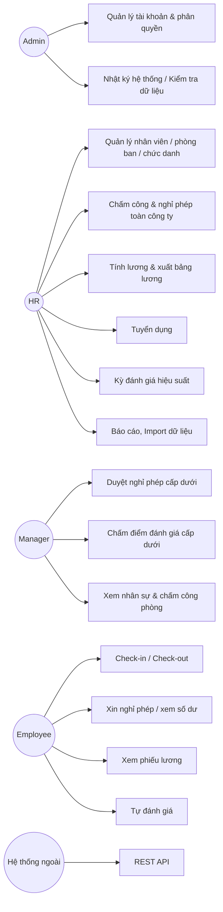
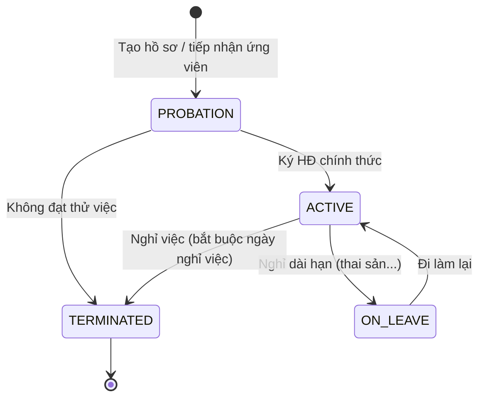
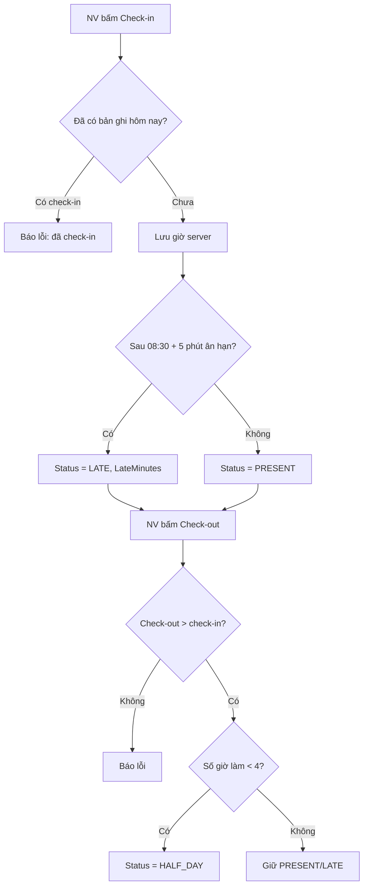
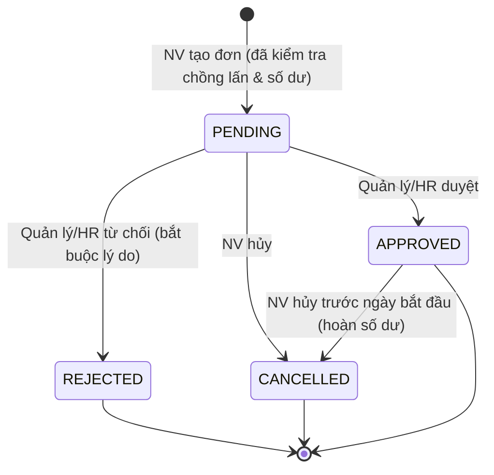
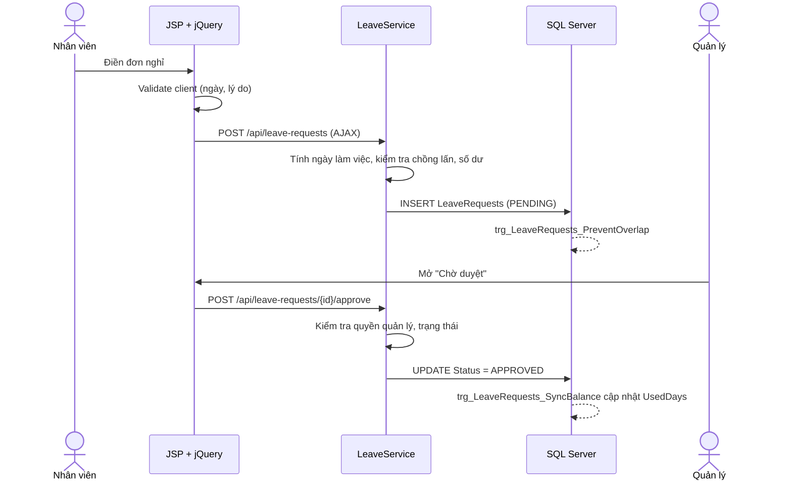
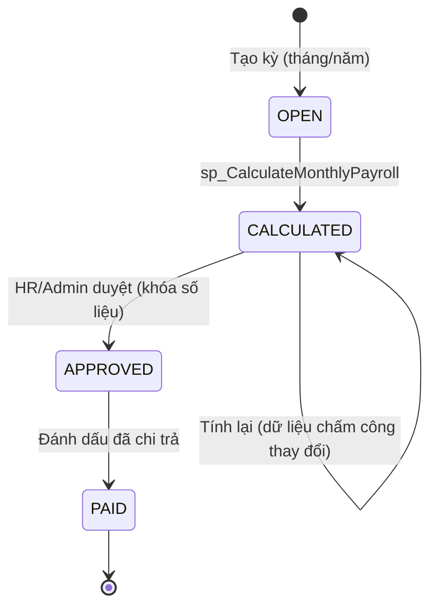
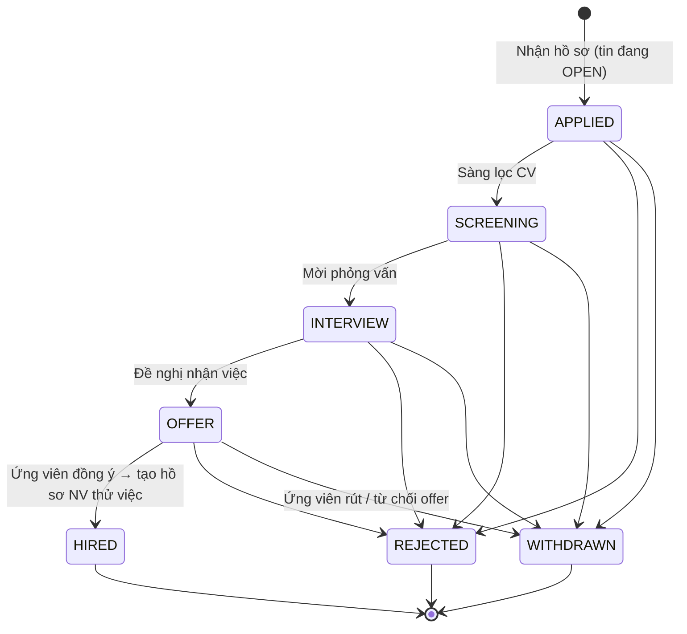
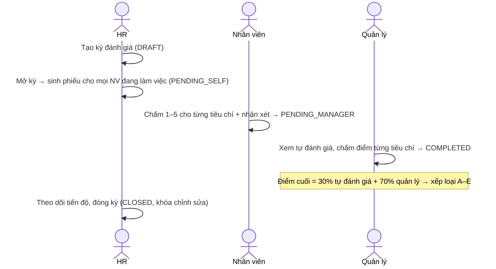

# 01 – Phân tích yêu cầu hệ thống HRM

> Phiên bản: 1.0 · Phạm vi: HRM System (Servlet/JSP + MS SQL Server)
> Mục đích: làm rõ actor, use case, quy trình nghiệp vụ và quy tắc nghiệp vụ trước khi thiết kế CSDL và mã nguồn.

## 1. Bối cảnh và mục tiêu

Doanh nghiệp vừa và nhỏ (~50–500 nhân sự) đang quản lý nhân sự bằng Excel rời rạc: hồ sơ nhân viên, bảng chấm công, đơn nghỉ phép giấy, bảng lương tính tay. Hệ quả: sai sót khi tính lương, khó kiểm soát ngày phép, không có số liệu tổng hợp cho ban giám đốc.

Mục tiêu của hệ thống HRM:

| # | Mục tiêu | Đo lường |
|---|----------|----------|
| G1 | Tập trung hồ sơ nhân sự vào một CSDL duy nhất, có ràng buộc toàn vẹn | 0 bản ghi trùng mã NV / email; script kiểm tra dữ liệu PASS |
| G2 | Số hóa chấm công và luồng duyệt nghỉ phép | 100% đơn nghỉ đi qua hệ thống, có lịch sử duyệt |
| G3 | Tự động tính lương tháng theo công thức chuẩn (BHXH, thuế TNCN) | Tính lương toàn công ty < 5 giây; khớp 100% với bộ kiểm thử |
| G4 | Quản lý quy trình tuyển dụng và đánh giá hiệu suất | Theo dõi pipeline ứng viên và tiến độ đánh giá theo kỳ |
| G5 | Cung cấp báo cáo và API tích hợp với hệ thống khác | Xuất Excel/CSV; REST API cho nhân viên và chấm công |

## 2. Phạm vi

**Trong phạm vi**

- Quản lý thông tin nhân viên, phòng ban, chức danh (kèm khung lương).
- Chấm công (check-in/check-out), đơn nghỉ phép và luồng duyệt, số dư phép năm.
- Tính lương tháng: lương cơ bản theo ngày công, phụ cấp, khấu trừ bảo hiểm, thuế TNCN lũy tiến, xuất bảng lương.
- Tuyển dụng: tin tuyển dụng, ứng viên, pipeline trạng thái hồ sơ, tiếp nhận ứng viên thành nhân viên.
- Đánh giá hiệu suất: kỳ đánh giá, tự đánh giá, quản lý chấm điểm theo tiêu chí có trọng số.
- Phân quyền theo vai trò (Admin/HR/Manager/Employee), nhật ký thao tác (audit log).
- Báo cáo thống kê, xuất Excel/CSV; REST API JSON; import dữ liệu CSV/Excel.

**Ngoài phạm vi (phiên bản này)**

- Tích hợp trực tiếp với máy chấm công vân tay (chỉ cung cấp API nhận dữ liệu).
- Làm thêm giờ (OT), ca kíp phức tạp, nhiều pháp nhân/chi nhánh, đa tiền tệ.
- Kê khai BHXH/thuế điện tử với cơ quan nhà nước.
- Single Sign-On (SSO/LDAP) – đề xuất trong kế hoạch cải tiến.

## 3. Actor

| Actor | Mô tả | Vai trò hệ thống |
|-------|-------|------------------|
| **Admin** | Quản trị hệ thống (IT) | `ADMIN` – toàn quyền, quản lý tài khoản, cấu hình, nhật ký, kiểm tra dữ liệu |
| **HR** | Chuyên viên / trưởng phòng nhân sự | `HR` – quản lý hồ sơ, chấm công, nghỉ phép, lương, tuyển dụng, đánh giá, báo cáo |
| **Manager** | Trưởng phòng / quản lý trực tiếp | `MANAGER` – xem nhân sự phòng mình, duyệt nghỉ phép, chấm điểm đánh giá, nhận xét ứng viên |
| **Employee** | Nhân viên | `EMPLOYEE` – tự phục vụ: hồ sơ cá nhân, chấm công, xin nghỉ, phiếu lương, tự đánh giá |
| **Hệ thống ngoài** | Máy chấm công, ERP, BI | API key – gọi REST API `/api/employees`, `/api/attendance` |

Một tài khoản có thể có nhiều vai trò (ví dụ trưởng phòng IT = `MANAGER` + `EMPLOYEE`). Quyền là hợp của các vai trò; `ADMIN` có toàn quyền.



## 4. Ma trận phân quyền

Ký hiệu: **F** = toàn quyền (thêm/sửa/xóa/duyệt) · **R** = chỉ xem · **T** = phạm vi đội nhóm (phòng ban mình quản lý + cấp dưới trực tiếp) · **S** = chỉ dữ liệu của bản thân · – = không có quyền.

| Chức năng | Admin | HR | Manager | Employee | API key |
|-----------|:-----:|:--:|:-------:|:--------:|:-------:|
| Tài khoản, vai trò, nhật ký, kiểm tra dữ liệu | F | – | – | – | – |
| Phòng ban, chức danh | F | F | R | – | R (phòng ban) |
| Hồ sơ nhân viên | F | F | R·T | R·S | F |
| Import nhân viên CSV/Excel | F | F | – | – | – |
| Check-in / check-out | S | S | S | S | – |
| Dữ liệu chấm công | F | F | R·T | R·S | F |
| Đơn nghỉ phép: tạo/hủy | S | S | S | S | – |
| Đơn nghỉ phép: duyệt/từ chối | F | F | F·T | – | – |
| Tính lương, duyệt, xuất bảng lương | F | F | – | – | – |
| Phiếu lương | F | F | S | S | – |
| Tin tuyển dụng, ứng viên | F | F | R·T (+ nhận xét) | – | – |
| Kỳ đánh giá (tạo/mở/đóng) | F | F | – | – | – |
| Phiếu đánh giá | F (xem) | R | F·T (chấm điểm) | S (tự đánh giá) | – |
| Báo cáo thống kê | F | F | R·T | – | – |

Phân quyền được thực thi **hai lớp**: (1) `AuthorizationFilter` chặn theo URL và vai trò; (2) tầng service kiểm tra phạm vi dữ liệu (đội nhóm / bản thân) để ngăn truy cập trực tiếp bằng ID (IDOR).

## 5. Danh sách use case

| Mã | Use case | Actor chính | Ưu tiên |
|----|----------|-------------|:------:|
| **Xác thực & quản trị** ||||
| UC-01 | Đăng nhập (khóa tài khoản sau 5 lần sai) | Tất cả | Must |
| UC-02 | Đăng xuất | Tất cả | Must |
| UC-03 | Đổi mật khẩu | Tất cả | Must |
| UC-04 | Quản lý tài khoản: tạo, gán vai trò, khóa/mở, đặt lại mật khẩu | Admin | Must |
| UC-05 | Xem nhật ký thao tác (audit log) | Admin | Should |
| UC-06 | Chạy kiểm tra toàn vẹn dữ liệu | Admin | Should |
| **Thông tin nhân viên** ||||
| UC-10 | Quản lý phòng ban (CRUD, chỉ định trưởng phòng) | HR | Must |
| UC-11 | Quản lý chức danh và khung lương (CRUD) | HR | Must |
| UC-12 | Tra cứu nhân viên: tìm kiếm, lọc, sắp xếp, phân trang | HR, Manager | Must |
| UC-13 | Thêm / sửa hồ sơ nhân viên | HR | Must |
| UC-14 | Xóa nhân viên (chỉ khi chưa phát sinh dữ liệu) | HR | Must |
| UC-15 | Xem hồ sơ chi tiết (lịch sử lương, số dư phép, chấm công gần đây) | HR, Manager | Should |
| UC-16 | Xem hồ sơ cá nhân | Employee | Must |
| UC-17 | Import nhân viên từ CSV/Excel, báo lỗi từng dòng | HR | Should |
| **Chấm công & nghỉ phép** ||||
| UC-20 | Check-in / check-out | Employee | Must |
| UC-21 | Xem lịch sử chấm công cá nhân và tổng hợp tháng | Employee | Must |
| UC-22 | Tra cứu, thêm, điều chỉnh bản ghi chấm công | HR (Manager: xem) | Must |
| UC-23 | Tạo đơn xin nghỉ phép | Employee | Must |
| UC-24 | Hủy đơn nghỉ phép | Employee | Must |
| UC-25 | Duyệt / từ chối đơn nghỉ phép | Manager, HR | Must |
| UC-26 | Xem số dư ngày phép theo năm | Employee | Must |
| UC-27 | Khởi tạo số dư phép năm | HR | Should |
| **Tính lương** ||||
| UC-30 | Tính lương tháng (gọi stored procedure) | HR | Must |
| UC-31 | Xem bảng lương kỳ và chi tiết phiếu lương | HR | Must |
| UC-32 | Duyệt bảng lương, đánh dấu đã chi trả | HR, Admin | Must |
| UC-33 | Xuất bảng lương Excel / CSV | HR | Must |
| UC-34 | Xem phiếu lương cá nhân | Employee | Must |
| UC-35 | Mô phỏng lương Gross → Net | HR, Employee | Could |
| **Tuyển dụng** ||||
| UC-40 | Quản lý tin tuyển dụng | HR | Must |
| UC-41 | Quản lý hồ sơ ứng viên | HR | Must |
| UC-42 | Chuyển trạng thái hồ sơ theo pipeline, xem lịch sử | HR (Manager: nhận xét) | Must |
| UC-43 | Tiếp nhận ứng viên trúng tuyển thành nhân viên thử việc | HR | Should |
| **Đánh giá hiệu suất** ||||
| UC-50 | Tạo / mở / đóng kỳ đánh giá | HR | Must |
| UC-51 | Tự đánh giá theo tiêu chí | Employee | Must |
| UC-52 | Quản lý chấm điểm cấp dưới | Manager | Must |
| UC-53 | Theo dõi tiến độ, kết quả đánh giá | HR | Should |
| **Báo cáo & tích hợp** ||||
| UC-60 | Dashboard theo vai trò | Tất cả | Must |
| UC-61 | Thống kê nhân sự theo phòng ban, xuất Excel/CSV | HR | Must |
| UC-62 | Báo cáo chấm công tháng, xuất Excel/CSV | HR | Must |
| UC-70 | REST API nhân viên `/api/employees` | Hệ thống ngoài | Must |
| UC-71 | REST API chấm công `/api/attendance` (nhận dữ liệu máy chấm công) | Hệ thống ngoài | Must |
| UC-72 | Công cụ dòng lệnh import dữ liệu (data migration) | Admin | Should |

### 5.1 Đặc tả một số use case tiêu biểu

**UC-01 – Đăng nhập**

| Mục | Nội dung |
|-----|----------|
| Tiền điều kiện | Tài khoản tồn tại, đang hoạt động |
| Luồng chính | 1. Người dùng nhập username/mật khẩu → 2. Hệ thống kiểm tra BCrypt → 3. Reset số lần sai, ghi `LastLoginAt`, đổi session id → 4. Chuyển tới Dashboard theo vai trò |
| Luồng phụ | 2a. Sai mật khẩu: tăng `FailedLoginCount`; đủ 5 lần → khóa 15 phút. 2b. Tài khoản bị khóa / vô hiệu hóa: báo lỗi chung "Tên đăng nhập hoặc mật khẩu không đúng / tài khoản đang bị khóa" |
| Hậu điều kiện | Ghi audit log `LOGIN_SUCCESS` / `LOGIN_FAILED` |

**UC-23 / UC-25 – Xin nghỉ phép và duyệt**

| Mục | Nội dung |
|-----|----------|
| Tiền điều kiện | Nhân viên có hồ sơ, đang làm việc |
| Luồng chính | 1. NV chọn loại phép, ngày bắt đầu/kết thúc, lý do → 2. Hệ thống tính số ngày làm việc (trừ T7, CN, ngày lễ) → 3. Kiểm tra chồng lấn và số dư → 4. Lưu đơn `PENDING` → 5. Quản lý thấy đơn trong "Chờ duyệt" → 6. Duyệt kèm ghi chú → 7. Trigger DB cập nhật `UsedDays` |
| Luồng phụ | 3a. Chồng lấn đơn khác → từ chối lưu. 3b. Không đủ số dư → từ chối lưu. 6a. Từ chối → bắt buộc nhập lý do. NV có thể hủy đơn `PENDING` hoặc đơn `APPROVED` chưa tới ngày nghỉ (số dư được hoàn lại) |

**UC-30 – Tính lương tháng**

| Mục | Nội dung |
|-----|----------|
| Tiền điều kiện | Kỳ lương ở trạng thái `OPEN` hoặc `CALCULATED` |
| Luồng chính | 1. HR chọn tháng/năm → 2. Hệ thống gọi `sp_CalculateMonthlyPayroll` → 3. SP tổng hợp ngày công, ngày nghỉ có lương, tính gross, bảo hiểm, thuế, net cho toàn bộ NV trong 1 transaction → 4. Kỳ lương chuyển `CALCULATED` → 5. HR xem, xuất Excel, duyệt → `APPROVED` → `PAID` |
| Luồng phụ | 2a. Kỳ đã `APPROVED`/`PAID` → SP báo lỗi, không tính lại. 3a. Lỗi bất kỳ → rollback toàn bộ |

**UC-71 – Nhận dữ liệu chấm công qua API**

| Mục | Nội dung |
|-----|----------|
| Tiền điều kiện | Hệ thống ngoài có API key hợp lệ (header `X-API-Key`) |
| Luồng chính | 1. Gửi `POST /api/attendance` với danh sách `{employeeCode, workDate, checkIn, checkOut}` → 2. Validate từng phần tử → 3. Upsert theo (nhân viên, ngày) → 4. Trả về số bản ghi thành công và lỗi từng phần tử |

## 6. Quy trình nghiệp vụ

### 6.1 Quản lý nhân viên – vòng đời hồ sơ



- Hồ sơ chỉ được **xóa cứng** khi chưa phát sinh chấm công, nghỉ phép, lương, đánh giá; ngược lại phải chuyển `TERMINATED` để giữ lịch sử.
- Khi nhân viên `TERMINATED`, tài khoản đăng nhập liên kết bị vô hiệu hóa.

### 6.2 Chấm công hằng ngày



### 6.3 Nghỉ phép – trạng thái đơn





### 6.4 Tính lương – trạng thái kỳ lương



**Công thức (đơn giản hóa, tham số cấu hình trong bảng `PayrollSettings`, `TaxBrackets`):**

```
Ngày công chuẩn (SD)   = số ngày làm việc trong tháng (T2–T6, trừ ngày lễ)
Ngày công hưởng lương  = min(SD, ngày đi làm [PRESENT/LATE = 1, HALF_DAY = 0.5] + ngày nghỉ có lương đã duyệt)
Lương theo ngày công   = Lương cơ bản × Ngày công hưởng lương / SD
Phụ cấp thực nhận      = Phụ cấp × Ngày công hưởng lương / SD
Gross                  = Lương theo ngày công + Phụ cấp thực nhận
Bảo hiểm NLĐ (10,5%)   = 8% BHXH + 1,5% BHYT trên min(Lương cơ bản, 20 × lương cơ sở)
                       + 1% BHTN trên min(Lương cơ bản, 20 × lương tối thiểu vùng)
                         (= 0 nếu số ngày không hưởng lương ≥ 14 ngày làm việc)
Thu nhập tính thuế     = max(0, Gross − Bảo hiểm − 15.500.000 − Số người phụ thuộc × 6.200.000)
Thuế TNCN              = Σ lũy tiến từng phần theo TaxBrackets
Thực lĩnh (Net)        = Gross − Bảo hiểm − Thuế TNCN
```

### 6.5 Tuyển dụng – pipeline hồ sơ ứng viên



Mọi lần đổi trạng thái được trigger `trg_Candidates_StageHistory` ghi vào `CandidateStageHistory` để đo thời gian xử lý từng bước (time-to-hire).

### 6.6 Đánh giá hiệu suất



## 7. Quy tắc nghiệp vụ (Business Rules)

### Nhân viên

| Mã | Quy tắc | Nơi thực thi |
|----|---------|--------------|
| BR-01 | Mã NV duy nhất, 3–20 ký tự `A-Z 0-9 -` (ví dụ `EMP0001`) | Service + UNIQUE + CHECK |
| BR-02 | Email duy nhất, đúng định dạng; CCCD 12 chữ số (nếu có), duy nhất; SĐT VN `0xxxxxxxxx` hoặc `+84…` | Service + UNIQUE |
| BR-03 | Lương cơ bản và phụ cấp không âm; lương cơ bản nằm trong khung lương (min–max) của chức danh | Service + CHECK (≥ 0) |
| BR-04 | Đủ 15 tuổi tại ngày vào làm | Service + CHECK |
| BR-05 | Ngày nghỉ việc ≥ ngày vào làm; `TERMINATED` ⇔ có ngày nghỉ việc | Service + CHECK |
| BR-06 | Không xóa NV đã phát sinh dữ liệu (chấm công, nghỉ phép, lương, đánh giá) | Service + FOREIGN KEY |
| BR-07 | Người quản lý không phải chính mình và không tạo vòng lặp quản lý | Service + CHECK |
| BR-08 | Thay đổi lương được ghi lịch sử (người sửa, thời điểm) | Trigger `trg_Employees_AuditSalary` |

### Chấm công & nghỉ phép

| Mã | Quy tắc |
|----|---------|
| BR-10 | Mỗi NV tối đa 1 bản ghi chấm công/ngày; giờ check-in/out lấy theo giờ server (múi giờ `Asia/Ho_Chi_Minh`) |
| BR-11 | Giờ vào chuẩn 08:30, ân hạn 5 phút; check-in sau 08:35 là `LATE` và lưu số phút đi muộn tính từ 08:30 |
| BR-12 | Check-out phải sau check-in; tổng giờ < 4 → `HALF_DAY` (0,5 công); được check-out lại (lấy lần cuối) |
| BR-13 | Ngày làm việc: thứ 2 – thứ 6, trừ ngày lễ trong bảng `Holidays` |
| BR-20 | Số ngày nghỉ = số ngày làm việc trong khoảng [bắt đầu, kết thúc], phải > 0; ngày bắt đầu không sớm hơn 30 ngày trước hôm nay |
| BR-21 | Không chồng lấn với đơn `PENDING`/`APPROVED` khác của cùng NV (service + trigger) |
| BR-22 | Loại phép có quản lý số dư (phép năm): số ngày xin ≤ được hưởng − đã dùng − đang chờ duyệt |
| BR-23 | Phép năm = 12 ngày + 1 ngày cho mỗi 5 năm thâm niên (tính đến 01/01); NV vào làm trong năm hưởng theo tỷ lệ số tháng làm việc (tháng vào làm được tính nếu vào trước hoặc đúng ngày 15), phần lẻ ≥ 0,5 làm tròn lên 1 ngày |
| BR-24 | Người duyệt: quản lý trực tiếp, trưởng phòng hoặc HR; không ai được tự duyệt đơn của mình; chỉ duyệt đơn `PENDING`; từ chối phải có lý do |
| BR-25 | NV được hủy đơn `PENDING`, hoặc đơn `APPROVED` có ngày bắt đầu sau hôm nay; số dư tự hoàn lại |

### Lương

| Mã | Quy tắc |
|----|---------|
| BR-30 | Mỗi NV có tối đa 1 dòng lương/kỳ; chỉ tính lại khi kỳ ở `OPEN`/`CALCULATED`; `APPROVED`/`PAID` là bất biến |
| BR-31 | NV thuộc kỳ lương nếu vào làm ≤ cuối tháng và (chưa nghỉ việc hoặc nghỉ việc ≥ đầu tháng) |
| BR-32 | Công thức như mục 6.4; mọi khoản làm tròn đến đồng (HALF_UP) |
| BR-33 | Lương thực lĩnh, gross, các khoản khấu trừ không âm (CHECK constraint) |
| BR-34 | Tham số (tỷ lệ bảo hiểm, lương cơ sở, giảm trừ gia cảnh, biểu thuế) lưu trong DB, không hardcode |

### Tuyển dụng & đánh giá

| Mã | Quy tắc |
|----|---------|
| BR-40 | Tin tuyển dụng: mã duy nhất, số lượng > 0, lương tối thiểu ≤ tối đa, ngày đóng ≥ ngày mở; chỉ nhận hồ sơ khi `OPEN` |
| BR-41 | Một ứng viên (email) chỉ nộp 1 lần cho 1 tin |
| BR-42 | Chuyển trạng thái theo đúng pipeline (mục 6.5); `HIRED`/`REJECTED`/`WITHDRAWN` là trạng thái kết thúc |
| BR-43 | Khi `HIRED` → tạo hồ sơ NV `PROBATION`; khi đủ số lượng tuyển → tin tự chuyển `CLOSED` |
| BR-50 | Kỳ đánh giá `DRAFT` → `OPEN` → `CLOSED`; mở kỳ sinh phiếu cho NV đang làm việc |
| BR-51 | Điểm tiêu chí 1–5; điểm tổng = bình quân gia quyền theo trọng số (tổng trọng số = 100) |
| BR-52 | Điểm cuối = 30% tự đánh giá + 70% quản lý; xếp loại A ≥ 4,5 · B ≥ 3,5 · C ≥ 2,5 · D ≥ 1,5 · E < 1,5 |
| BR-53 | Thứ tự: tự đánh giá → quản lý chấm; kỳ `CLOSED` không cho sửa |

## 8. Yêu cầu phi chức năng

| Mã | Nhóm | Yêu cầu |
|----|------|---------|
| NFR-01 | Bảo mật | Mật khẩu băm BCrypt (cost 10); mật khẩu ≥ 8 ký tự gồm chữ hoa, chữ thường, chữ số |
| NFR-02 | Bảo mật | 100% truy vấn dùng `PreparedStatement`/`CallableStatement`; cột sắp xếp dùng whitelist |
| NFR-03 | Bảo mật | Escape output JSP (`<c:out>`), render dữ liệu AJAX bằng `.text()`, Content-Security-Policy `script-src 'self'` |
| NFR-04 | Bảo mật | CSRF token cho mọi request thay đổi dữ liệu; cookie `HttpOnly`, `SameSite=Lax`; đổi session id sau đăng nhập; timeout 30 phút |
| NFR-05 | Bảo mật | Không hardcode thông tin nhạy cảm: chuỗi kết nối, mật khẩu, API key lấy từ biến môi trường |
| NFR-06 | Bảo mật | Ứng dụng kết nối DB bằng login riêng `hrm_app` với quyền tối thiểu (không dùng `sa`) |
| NFR-07 | Hiệu năng | Danh sách phân trang phía server; truy vấn chính < 200 ms với 100.000 bản ghi chấm công (có index) |
| NFR-08 | Hiệu năng | Connection pool HikariCP; tính lương set-based trong 1 stored procedure |
| NFR-09 | Vận hành | Logging SLF4J/Logback, mỗi request có `requestId` (hiển thị trên trang lỗi để tra log), cảnh báo truy vấn chậm |
| NFR-10 | Vận hành | Xử lý lỗi tập trung: lỗi nghiệp vụ → thông báo thân thiện; lỗi hệ thống → trang 500 không lộ stack trace; mất kết nối DB → 503 |
| NFR-11 | Khả dụng | Giao diện tiếng Việt, responsive (Bootstrap 5), thao tác CRUD bằng AJAX không tải lại trang |
| NFR-12 | Chất lượng | Validate cả client và server; unit test ≥ 60% coverage tầng service; CI chạy test mỗi lần push |
| NFR-13 | Triển khai | Đóng gói WAR chạy trên Tomcat 10.1 / Java 17; Docker Compose khởi chạy app + SQL Server bằng 1 lệnh |

## 9. Giả định và ràng buộc

- Một pháp nhân, một múi giờ (`Asia/Ho_Chi_Minh`), tiền tệ VND (không có phần thập phân).
- Tuần làm việc 5 ngày (T2–T6); lịch nghỉ lễ do HR cập nhật hằng năm trong bảng `Holidays`.
- Công thức lương/thuế là **mô hình đơn giản hóa** phục vụ demo: không xét thu nhập miễn thuế, làm thêm giờ, thưởng; các tham số (giảm trừ gia cảnh 15,5 triệu / 6,2 triệu theo NQ 110/2025/UBTVQH15, lương cơ sở 2,34 triệu, lương tối thiểu vùng I 5,31 triệu, biểu thuế 7 bậc) cần được HR/kế toán xác nhận theo văn bản hiện hành trước khi dùng thực tế.
- Trình duyệt hỗ trợ: Chrome, Edge, Firefox bản mới.

## 10. Truy vết yêu cầu → thiết kế

| Yêu cầu | Thiết kế / hiện thực |
|---------|---------------------|
| Hồ sơ NV, phòng ban, chức danh | Bảng `Employees`, `Departments`, `Positions`; `EmployeeService`, `/employees` |
| Chấm công, nghỉ phép | `Attendance`, `LeaveRequests`, `LeaveTypes`, `LeaveBalances`, `Holidays`; trigger chống chồng lấn |
| Tính lương | `PayrollPeriods`, `Payroll`, `PayrollSettings`, `TaxBrackets`; `sp_CalculateMonthlyPayroll`; `PayrollCalculator` (Java) |
| Tuyển dụng | `JobPostings`, `Candidates`, `CandidateStageHistory` |
| Đánh giá | `ReviewCycles`, `ReviewCriteria`, `PerformanceReviews`, `ReviewScores` |
| Phân quyền | `Users`, `Roles`, `UserRoles`; `AuthenticationFilter`, `AuthorizationFilter`, `AccessPolicy` |
| Báo cáo | `vw_EmployeeDetails`, `vw_MonthlyAttendanceSummary`, `sp_GetDepartmentStatistics`, `sp_GetAttendanceReport`; Apache POI |
| Tích hợp | `/api/employees`, `/api/attendance`; `EmployeeImportService`, `DataImportTool` |
| Toàn vẹn dữ liệu | Ràng buộc PK/FK/UNIQUE/CHECK; `sp_RunDataValidation`; `db/data-validation.sql` |
