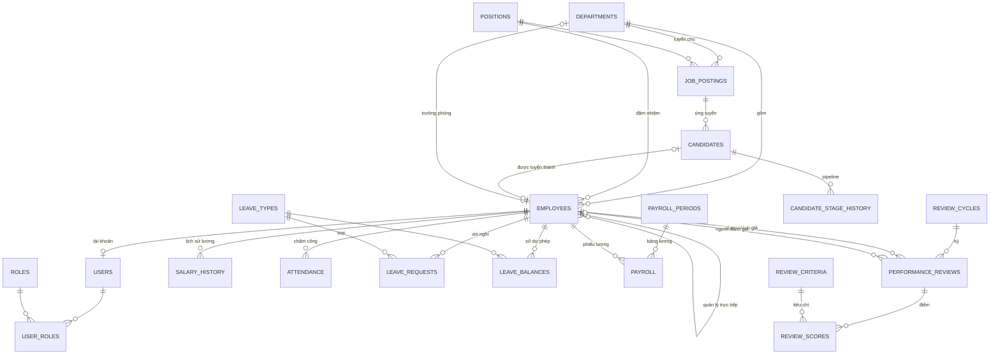
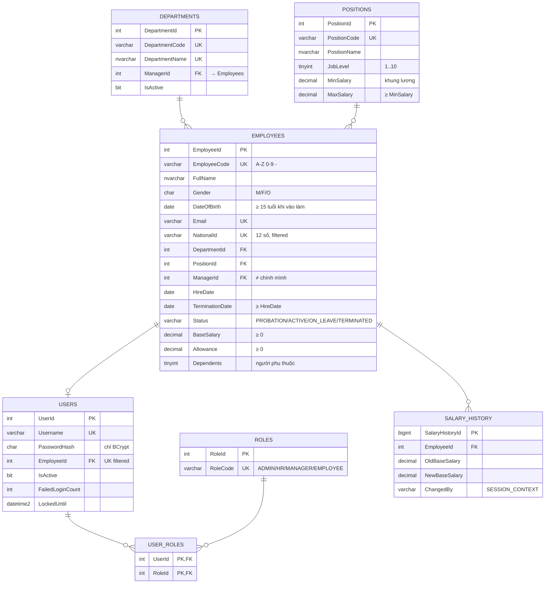
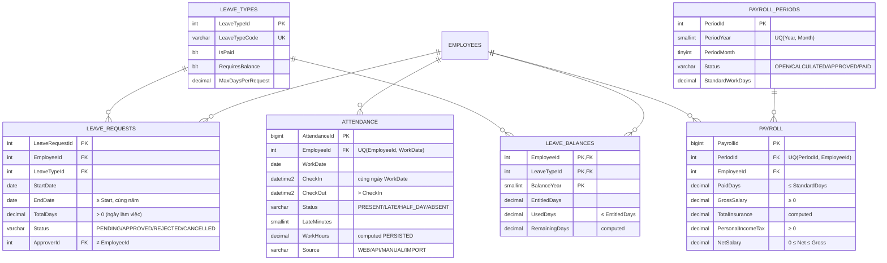
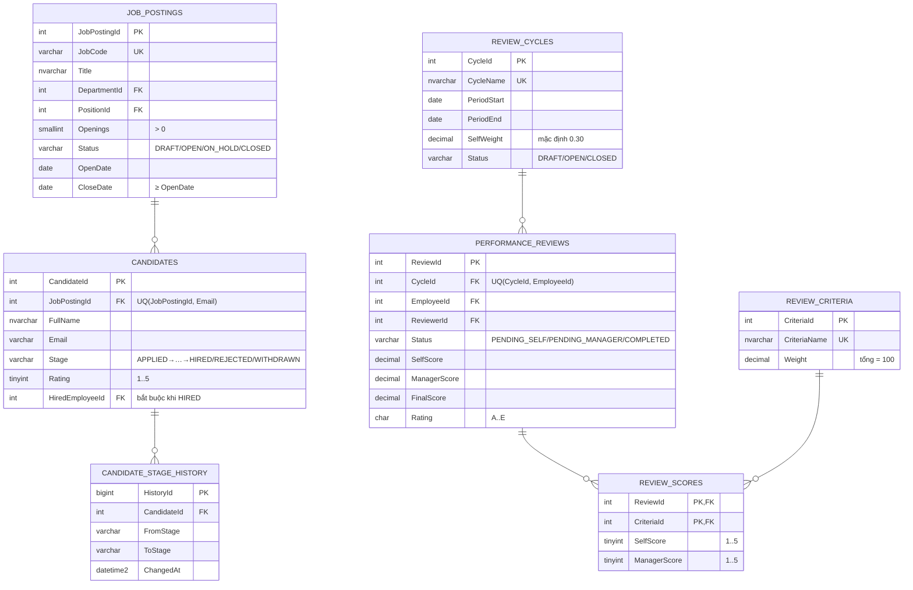

# 02 – Thiết kế cơ sở dữ liệu

> CSDL: Microsoft SQL Server 2019+ (kiểm thử trên SQL Server 2022 CU27) · Database `HRM` · 24 bảng
> Script: [`db/`](../db) – thứ tự chạy được định nghĩa trong [`db/init-db.sh`](../db/init-db.sh)

## 1. Quy ước thiết kế

| Hạng mục | Quy ước | Lý do |
|----------|---------|-------|
| Khóa chính | `<Bảng>Id` `INT`/`BIGINT IDENTITY` (surrogate key); mã nghiệp vụ (`EmployeeCode`, `JobCode`…) là `UNIQUE` | Mã nghiệp vụ có thể đổi; khóa số nhỏ gọn cho FK và clustered index |
| Tên ràng buộc | `PK_`, `FK_<Con>_<Cha>`, `UQ_`/`UX_` (unique index), `CK_`, `DF_`, `IX_` | Đặt tên tường minh → thông báo lỗi dễ đọc, map sang thông điệp nghiệp vụ trong Java |
| Tiền | `DECIMAL(18,2)` (VND), làm tròn đến đồng khi tính | Không dùng `FLOAT`/`MONEY` để tránh sai số |
| Ngày | `DATE` cho ngày nghiệp vụ (vào làm, nghỉ phép…) | |
| Thời điểm hệ thống | `DATETIME2(0)` theo **UTC** (`SYSUTCDATETIME()`): `CreatedAt`, `UpdatedAt`, `DecidedAt`… | Không phụ thuộc múi giờ server (Azure SQL luôn chạy UTC) |
| Giờ chấm công | `CheckIn`/`CheckOut` là giờ địa phương công ty (`Asia/Ho_Chi_Minh`) do ứng dụng ghi | Gắn với `WorkDate` và quy tắc đi muộn |
| Văn bản tiếng Việt | `NVARCHAR`; mã, email dùng `VARCHAR` | Tiết kiệm dung lượng cho dữ liệu ASCII |
| Trạng thái | `VARCHAR(20)` + `CHECK (... IN (...))` | Dễ đọc khi truy vấn tay, tương ứng `enum` Java |
| Xóa dữ liệu | FK mặc định `NO ACTION`; chỉ `CASCADE` cho dữ liệu "thuộc về" bản ghi cha (`UserRoles`, `Payroll` của kỳ lương, `ReviewScores`…) | Không mất lịch sử nghiệp vụ do xóa nhầm |

### 1.1 Lựa chọn collation: `Latin1_General_100_CI_AI`

Người dùng HR thường gõ không dấu khi tìm kiếm. Kết quả thử nghiệm trên SQL Server 2022:

| Phép so sánh | `Vietnamese_100_CI_AI` | `Latin1_General_100_CI_AI` |
|--------------|:----------------------:|:--------------------------:|
| `N'Nguyễn' = N'nguyen'` | ❌ 0 | ✅ 1 |
| `N'Tuấn' = N'tuan'` | ❌ 0 | ✅ 1 |
| `N'Đức' = N'duc'` | ❌ 0 | ✅ 1 |
| `N'Trần Thị Hồng Nhung' LIKE N'%hong nhung%'` | ❌ 0 | ✅ 1 |

Collation tiếng Việt coi `ê, ă, ơ, đ…` là chữ cái riêng nên không bỏ dấu được. Vì vậy database dùng
`Latin1_General_100_CI_AI`: tìm "nguyen van" ra "Nguyễn Văn", đồng thời `UNIQUE` trên tên phòng ban cũng
chặn "Kế toán" và "Ke toan" trùng nhau. Đánh đổi: thứ tự sắp xếp gần đúng thứ tự từ điển tiếng Việt (Đ xếp cùng D) – chấp nhận được.

> Lưu ý: collation của `tempdb` (mặc định server) khác collation database. Bảng tạm `#temp` có cột chuỗi phải
> khai báo `COLLATE DATABASE_DEFAULT` khi JOIN với bảng thật; stored procedure trong dự án dùng biến bảng/CTE để tránh vấn đề này.

## 2. Sơ đồ quan hệ (ERD)

### 2.1 Tổng quan



Bảng độc lập: `Holidays` (lịch nghỉ lễ), `PayrollSettings`, `TaxBrackets` (tham số lương), `AuditLogs` (nhật ký).

### 2.2 Nhân sự & phân quyền



### 2.3 Chấm công, nghỉ phép, lương



### 2.4 Tuyển dụng & đánh giá hiệu suất



## 3. Từ điển dữ liệu (tóm tắt)

| Bảng (yêu cầu gốc) | Bảng thực tế | Mục đích | Ràng buộc đáng chú ý |
|--------------------|--------------|----------|----------------------|
| Departments | `Departments` | Phòng ban | Mã & tên unique, trưởng phòng là FK vòng tới `Employees` (thêm sau bằng `ALTER TABLE`) |
| Positions | `Positions` | Chức danh, cấp bậc, khung lương | `MinSalary ≤ MaxSalary`, cấp 1–10 |
| Employees | `Employees` | Hồ sơ nhân viên | 11 CHECK: mã NV, giới tính, email, CCCD 12 số, lương ≥ 0, tuổi ≥ 15, ngày nghỉ việc, trạng thái… |
| – | `SalaryHistory` | Lịch sử thay đổi lương | Ghi bởi trigger |
| Users, Roles, UserRoles | `Users`, `Roles`, `UserRoles` | Tài khoản, vai trò (n-n) | `PasswordHash` chỉ chấp nhận định dạng BCrypt `$2a$10$…`; mỗi NV tối đa 1 tài khoản (filtered unique) |
| Attendance | `Attendance` | Chấm công theo ngày | `UQ(EmployeeId, WorkDate)`; check-out > check-in; check-in cùng ngày; `WorkHours` computed persisted |
| Leave | `LeaveRequests`, `LeaveTypes`, `LeaveBalances` | Đơn nghỉ, loại phép, số dư | Không qua 2 năm, `TotalDays > 0`, không tự duyệt; `UsedDays ≤ EntitledDays` |
| – | `Holidays` | Ngày lễ (không tính công) | PK = ngày |
| Payroll | `PayrollPeriods`, `Payroll` | Kỳ lương, chi tiết lương từng NV | `UQ(PeriodId, EmployeeId)`; mọi khoản ≥ 0; `Net ≤ Gross`; `PaidDays ≤ StandardDays` |
| – | `PayrollSettings`, `TaxBrackets` | Tham số bảo hiểm, giảm trừ, biểu thuế | Giá trị ≥ 0, `0 < Rate < 1` |
| Recruitment | `JobPostings` | Tin tuyển dụng | Số lượng > 0, khung lương, ngày đóng ≥ ngày mở |
| Candidates | `Candidates`, `CandidateStageHistory` | Ứng viên & lịch sử pipeline | `UQ(JobPostingId, Email)`, `HIRED` bắt buộc có `HiredEmployeeId` |
| PerformanceReviews | `ReviewCycles`, `ReviewCriteria`, `PerformanceReviews`, `ReviewScores` | Kỳ, tiêu chí, phiếu, điểm | Điểm 1–5, xếp loại A–E, `COMPLETED` bắt buộc có điểm cuối |
| – | `AuditLogs` | Nhật ký thao tác | Index theo thời gian và đối tượng |

## 4. Toàn vẹn dữ liệu – business rule ↔ cơ chế DB

| Business rule | Cơ chế trong CSDL |
|---------------|-------------------|
| BR-01 Mã NV duy nhất, đúng định dạng | `UQ_Employees_EmployeeCode`, `CK_Employees_Code` (so sánh `COLLATE Latin1_General_BIN2` để bắt buộc chữ hoa) |
| BR-02 Email/CCCD duy nhất | `UQ_Employees_Email`, `UX_Employees_NationalId` (filtered `WHERE NationalId IS NOT NULL` → cho phép nhiều NULL) |
| BR-03 Lương không âm | `CK_Employees_Salary`, `CK_Payroll_NonNegative` |
| BR-04/05/07 Tuổi, ngày nghỉ việc, quản lý ≠ bản thân | `CK_Employees_MinAge`, `CK_Employees_TermDate`, `CK_Employees_Terminated`, `CK_Employees_SelfManager` |
| BR-06 Không xóa NV có dữ liệu | FK `NO ACTION` từ `Attendance`, `LeaveRequests`, `Payroll`, `PerformanceReviews`… |
| BR-08 Lịch sử lương | Trigger `trg_Employees_AuditSalary` (người sửa lấy từ `SESSION_CONTEXT('app_user')`) |
| NV nghỉ việc không đăng nhập được | Trigger `trg_Employees_DeactivateUser` |
| BR-10 1 bản ghi chấm công/ngày | `UQ_Attendance_EmployeeDate`, `CK_Attendance_CheckOrder`, `CK_Attendance_SameDay` |
| BR-21 Nghỉ phép không chồng lấn | Trigger `trg_LeaveRequests_PreventOverlap` → lỗi `51001` |
| BR-22 Không vượt số dư phép | Trigger `trg_LeaveRequests_SyncBalance` + `CK_LeaveBalances_Days` |
| BR-30 1 dòng lương/NV/kỳ | `UQ_Payroll_PeriodEmployee`, `UQ_PayrollPeriods_YearMonth` |
| BR-41 Ứng viên không nộp trùng | `UQ_Candidates_JobEmail` |
| BR-42 Lịch sử pipeline | Trigger `trg_Candidates_StageHistory` |
| Không lưu mật khẩu dạng rõ | `CK_Users_PasswordHash` (`LIKE '$2[aby]$[0-9][0-9]$%'`) |

**Nguyên tắc "defense in depth":** tầng service kiểm tra trước để trả thông báo thân thiện; CSDL là chốt chặn cuối cùng
cho mọi nguồn ghi (web, REST API, import, SQL tay). Lớp DAO dịch mã lỗi SQL Server sang ngoại lệ nghiệp vụ:
`2627/2601` → trùng dữ liệu, `547` → vi phạm ràng buộc, `51001–51999` → lỗi nghiệp vụ do trigger/SP ném ra.

## 5. Chiến lược index

| Index | Phục vụ truy vấn |
|-------|------------------|
| `IX_Employees_DepartmentId (DepartmentId) INCLUDE (Status, PositionId)` | Lọc NV theo phòng ban, thống kê headcount |
| `IX_Employees_Status INCLUDE (DepartmentId, HireDate, TerminationDate)` | Đếm NV đang làm việc, NV thuộc kỳ lương |
| `IX_Employees_FullName` | Sắp xếp/phân trang theo tên, tìm theo tiền tố |
| `IX_Employees_ManagerId` (filtered `IS NOT NULL`) | Danh sách cấp dưới của quản lý |
| `UQ_Attendance_EmployeeDate (EmployeeId, WorkDate)` | Check-in hôm nay, lịch sử chấm công một NV |
| `IX_Attendance_WorkDate INCLUDE (EmployeeId, Status, LateMinutes, WorkHours)` | Báo cáo theo tháng toàn công ty (covering index) – phân tích chi tiết ở [03-query-optimization.md](03-query-optimization.md) |
| `IX_LeaveRequests_Employee_Dates (EmployeeId, StartDate, EndDate) INCLUDE (...)` | Kiểm tra chồng lấn, đơn của tôi |
| `IX_LeaveRequests_Pending` (filtered `Status = 'PENDING'`) | Hàng đợi duyệt – index rất nhỏ vì chỉ chứa đơn chờ |
| `IX_Payroll_EmployeeId INCLUDE (PeriodId, GrossSalary, NetSalary)` | Lịch sử phiếu lương của NV |
| `IX_PerformanceReviews_Reviewer (ReviewerId, Status)` | "Phiếu cần tôi chấm" |
| Index trên mọi cột FK còn lại | Tránh scan khi xóa/cập nhật bảng cha và khi JOIN |

> Filtered index và cột computed được index yêu cầu `SET QUOTED_IDENTIFIER ON` khi tạo đối tượng và khi ghi dữ liệu.
> `init-db.sh` luôn gọi `sqlcmd -I`; JDBC mặc định đã bật. (Xem sự cố #4 trong `06-troubleshooting-log.md`.)

## 6. Trigger

| Trigger | Sự kiện | Chức năng |
|---------|---------|-----------|
| `trg_Employees_AuditSalary` | AFTER INSERT, UPDATE | Ghi `SalaryHistory` khi lương/phụ cấp thực sự thay đổi |
| `trg_Employees_DeactivateUser` | AFTER UPDATE | NV chuyển `TERMINATED` → khóa tài khoản |
| `trg_LeaveRequests_PreventOverlap` | AFTER INSERT, UPDATE | `THROW 51001` nếu chồng lấn đơn `PENDING`/`APPROVED` |
| `trg_LeaveRequests_SyncBalance` | AFTER INSERT, UPDATE, DELETE | Tính lại `UsedDays` từ các đơn `APPROVED` (idempotent) |
| `trg_Candidates_StageHistory` | AFTER INSERT, UPDATE | Ghi lịch sử chuyển trạng thái ứng viên |

Tất cả trigger viết **set-based** (JOIN `inserted`/`deleted`), an toàn với lệnh tác động nhiều dòng.

## 7. Hàm dùng chung

`dbo.fn_WorkingDays(@From, @To)` – **inline TVF** trả về các ngày làm việc (T2–T6, trừ `Holidays`).
Dùng cho: tính số ngày nghỉ, ngày công chuẩn của kỳ lương, báo cáo vắng mặt. Không phụ thuộc `@@DATEFIRST`
(dựa trên mốc 1900-01-01 là thứ Hai). Lớp Java `WorkingDayCalculator` hiện thực cùng quy tắc.

## 8. Dữ liệu mẫu (`db/seed.sql`)

| Dữ liệu | Số lượng | Ghi chú |
|---------|---------:|---------|
| Phòng ban | 6 | BOD, HR, FIN, IT, SALES, MKT – đều có trưởng phòng |
| Chức danh | 13 | Có cấp bậc và khung lương |
| Nhân viên | 36 | Đủ trạng thái: thử việc, chính thức, nghỉ thai sản, đã nghỉ việc; quan hệ quản lý 3 cấp |
| Tài khoản | 33 | Mật khẩu `Demo@123` (BCrypt) |
| Ngày lễ | 23 | 2025–2026 (chỉ ngày làm việc) |
| Chấm công | ~2.000+ | Mọi ngày làm việc từ 01/08/2026 đến hôm qua (+ check-in hôm nay); phân bố tất định ~10% muộn, 3% nửa ngày, 2% vắng |
| Đơn nghỉ phép | 20 | Đủ 4 trạng thái, nhiều loại phép |
| Tin tuyển dụng / ứng viên | 5 / 16 | Đủ các bước pipeline, 40 dòng lịch sử |
| Kỳ đánh giá / phiếu | 2 / 63 | Kỳ đã đóng (hoàn tất) và kỳ đang mở (đủ trạng thái) |

**Tài khoản demo**

| Username | Vai trò | Nhân viên |
|----------|---------|-----------|
| `admin` | ADMIN, EMPLOYEE | EMP0012 – Phan Thanh Sơn (Quản trị hệ thống) |
| `hr` | HR, MANAGER, EMPLOYEE | EMP0003 – Lê Thị Lan (Trưởng phòng Nhân sự) |
| `manager` | MANAGER, EMPLOYEE | EMP0011 – Trịnh Đức Minh (Trưởng phòng CNTT) |
| `employee` | EMPLOYEE | EMP0016 – Trần Quốc Việt (Lập trình viên) |
| `emp0013` | MANAGER, EMPLOYEE | EMP0013 – Lý Hoàng Nam (Trưởng nhóm, quản lý trực tiếp các dev) |
| `emp00xx` | EMPLOYEE (+ MANAGER với trưởng phòng) | Các nhân viên còn lại |

Dữ liệu chấm công được sinh bằng `CHECKSUM(EmployeeId, WorkDate)` thay vì `NEWID()` → chạy lại seed cho kết quả
giống hệt nhau (tái lập được khi kiểm thử và viết tài liệu).

## 9. Cách chạy

```bash
# SQL Server chạy bằng Docker (môi trường dev)
docker run -d --name hrm-db -e ACCEPT_EULA=Y -e MSSQL_SA_PASSWORD='<StrongPassword>' \
  -e TZ=Asia/Ho_Chi_Minh -p 1433:1433 mcr.microsoft.com/mssql/server:2022-latest

# Khởi tạo CSDL (cần sqlcmd; hoặc chạy bên trong container như dưới)
docker cp db hrm-db:/db
docker exec -e DB_ADMIN_PASSWORD='<StrongPassword>' hrm-db bash /db/init-db.sh
```

Thứ tự: `create-database.sql` → `schema.sql` → `functions.sql` → `views.sql` → `procedures.sql` → `triggers.sql` → `seed.sql` → `security.sql`.

## 10. Kết quả tự kiểm tra (Bước 2)

Mỗi thao tác vi phạm được chạy trong transaction rồi `ROLLBACK`:

| Thao tác vi phạm | Kết quả |
|------------------|---------|
| Cập nhật lương = −5.000.000 | `Msg 547` – `CK_Employees_Salary` ✅ |
| Thêm NV trùng mã `EMP0001` | `Msg 2627` – `UQ_Employees_EmployeeCode` ✅ |
| Thêm NV mã chữ thường `emp9999` | `Msg 547` – `CK_Employees_Code` ✅ |
| Tạo đơn nghỉ chồng lấn đơn đang chờ | `Msg 51001` – trigger `trg_LeaveRequests_PreventOverlap` ✅ |
| Duyệt đơn 14 ngày khi chỉ còn 10 ngày phép | `Msg 547` – `CK_LeaveBalances_Days` (qua trigger đồng bộ số dư) ✅ |
| Lưu mật khẩu dạng rõ | `Msg 547` – `CK_Users_PasswordHash` ✅ |
| Đơn nghỉ từ 30/12/2026 đến 02/01/2027 | `Msg 547` – `CK_LeaveRequests_Dates` ✅ |
| Tăng lương EMP0016 với `app_user = hr` | `SalaryHistory`: 22.000.000 → 24.000.000, `ChangedBy = hr` ✅ |
| Chuyển EMP0017 sang `TERMINATED` | Tài khoản `emp0017` tự động `IsActive = 0` ✅ |
