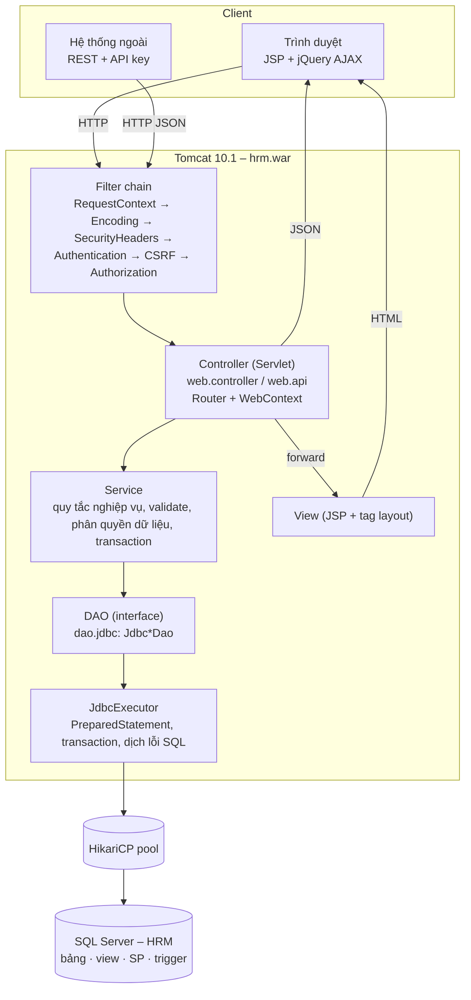

# 04 – Kiến trúc ứng dụng

> Java 17 · Jakarta Servlet 6 / JSP 3.1 / JSTL 3 · Tomcat 10.1 · JDBC + HikariCP · SQL Server · jQuery + Bootstrap 5
> Không dùng framework DI/ORM: mọi thành phần được nối bằng constructor injection trong một *composition root* –
> giúp thấy rõ luồng dữ liệu, dễ kiểm thử bằng Mockito và đúng với yêu cầu "Servlet/JSP + JDBC" của JD.

## 1. Tổng quan phân lớp



| Lớp | Package | Trách nhiệm | Không được làm |
|-----|---------|-------------|----------------|
| Model | `com.hrm.model` | Entity (POJO có getter cho JSP/EL), DTO/record cho request, enum trạng thái, `Page`/`PageRequest` | Chứa logic truy cập DB |
| DAO | `com.hrm.dao` (interface), `com.hrm.dao.jdbc` (JDBC) | SQL, map `ResultSet` → model, gọi stored procedure | Quyết định nghiệp vụ |
| Service | `com.hrm.service` | Business rules (BR-xx), validate server-side, kiểm tra quyền theo phạm vi dữ liệu, transaction, audit | Biết về HTTP/Servlet |
| Controller | `com.hrm.web.controller` (trang), `com.hrm.web.api` (JSON) | Đọc tham số, gọi service, chọn view/JSON | Viết SQL, chứa business rule |
| View | `src/main/webapp/WEB-INF/views`, `assets/js` | Hiển thị (escape output), tương tác AJAX | Truy cập DB, logic nghiệp vụ |
| Hạ tầng | `config`, `security`, `web.filter`, `util`, `exception` | Cấu hình, bootstrap, bảo mật, logging, xử lý lỗi | – |

## 2. Cấu trúc mã nguồn

```
src/main/java/com/hrm
├── config/          AppConfig (properties + ${ENV:default}), DataSourceFactory (HikariCP),
│                    AppContext (composition root), AppBootstrap (đăng ký filter/servlet)
├── exception/       AppException → ValidationException 400, UnauthorizedException 401,
│                    ForbiddenException 403, NotFoundException 404, BusinessException 409,
│                    DataIntegrityException 409, DataAccessException 500, DatabaseUnavailableException 503
├── model/           Employee, Department, LeaveRequest, Payslip… + Page/PageRequest
├── dao/             *Dao interfaces, TransactionManager
│   └── jdbc/        JdbcExecutor, SqlErrorTranslator, SqlWhere, RowMapper, Rows, Jdbc*Dao
├── service/         EmployeeService, LeaveService, PayrollService, PayrollCalculator…
├── security/        AuthUser, Role, UserContext, PasswordHasher (BCrypt), AccessPolicy, CsrfTokens
├── web/             BaseController, Router, WebContext, ErrorHandler, ErrorResponse
│   ├── filter/      RequestContextFilter, CharacterEncodingFilter, SecurityHeadersFilter,
│   │                AuthenticationFilter, CsrfFilter, AuthorizationFilter
│   ├── controller/  servlet trả trang JSP, file Excel/CSV
│   └── api/         servlet REST JSON (/api/...)
├── report/          xuất Excel (Apache POI) / CSV
└── tools/           DataImportTool – công cụ dòng lệnh import dữ liệu
src/main/resources   db.properties, app.properties, logback.xml
src/main/webapp      WEB-INF/web.xml, WEB-INF/tags/layout.tag, WEB-INF/views/**.jsp,
                     assets/css/app.css, assets/js/app.js, assets/js/pages/*.js
```

## 3. Vòng đời một request

### 3.1 Khởi động

`web.xml` chỉ khai báo `AppBootstrap` (ServletContextListener). Khi Tomcat deploy:

1. `AppConfig.load("db.properties", "app.properties")` – thay thế `${HRM_DB_PASSWORD:}`… bằng biến môi trường.
2. `AppContext.create(config)` – tạo DataSource, `JdbcExecutor`, DAO, service theo đúng thứ tự phụ thuộc.
3. Đăng ký **filter theo thứ tự cố định** và **servlet với dependency truyền qua constructor**
   (`sc.addServlet("employees", new EmployeeController(employeeService, …))`).
   `metadata-complete="true"` tắt quét annotation trong ~40 JAR → Tomcat deploy WAR trong ~1 giây.

### 3.2 Request AJAX (ví dụ duyệt đơn nghỉ phép)

```mermaid
sequenceDiagram
    participant JS as leave-approvals.js
    participant RC as RequestContextFilter
    participant AF as Auth/CSRF/Authorization filters
    participant CT as LeaveApiController
    participant SV as LeaveService
    participant DAO as JdbcLeaveDao
    participant DB as SQL Server
    JS->>RC: POST /api/leave-requests/42/approve (X-CSRF-Token)
    RC->>RC: requestId → MDC, header X-Request-Id
    RC->>AF: chain
    AF->>AF: session → AuthUser (UserContext), kiểm tra CSRF, quyền URL
    AF->>CT: chain
    CT->>CT: Router khớp "/{id}/approve"
    CT->>SV: approve(user, 42, comment)
    SV->>SV: kiểm tra trạng thái PENDING, quyền quản lý (BR-24)
    SV->>DAO: updateDecision(...) trong inTransaction
    DAO->>DB: EXEC sp_set_session_context 'app_user'; UPDATE LeaveRequests ...
    DB-->>DB: trigger đồng bộ số dư phép
    DB-->>DAO: OK / lỗi 547, 51001
    DAO-->>SV: (SqlErrorTranslator → BusinessException)
    SV-->>CT: LeaveRequest
    CT-->>JS: 200 JSON  |  409 {message, requestId}
```

Mọi exception thoát khỏi handler được `BaseController` chuyển cho `ErrorHandler` – controller không có `try/catch`.

### 3.3 Request trang (JSP)

Controller đặt thuộc tính (`ctx.attr("departments", …)`) rồi `ctx.render("employees/list")` → forward tới
`/WEB-INF/views/employees/list.jsp`. JSP dùng tag `<t:layout>` (navbar, menu theo vai trò) và chỉ nạp file JS
của trang qua thuộc tính `script` – không có JavaScript inline.

## 4. Áp dụng SOLID

| Nguyên tắc | Cách áp dụng |
|------------|--------------|
| **S** – Single responsibility | `JdbcExecutor` chỉ lo JDBC; `SqlErrorTranslator` chỉ dịch lỗi; `PayrollCalculator` chỉ tính lương (hàm thuần); `ErrorHandler` chỉ chuyển exception → response; mỗi filter một mối quan tâm |
| **O** – Open/closed | Thêm endpoint = thêm 1 dòng `r.get(...)` trong `routes()`; thêm định dạng xuất = cài đặt `ReportExporter` mới (Excel, CSV); thêm thông điệp ràng buộc = thêm 1 entry trong bảng ánh xạ |
| **L** – Liskov | Service chỉ dùng interface DAO, mọi cài đặt (JDBC thật, mock trong test) thay thế được cho nhau |
| **I** – Interface segregation | DAO tách theo aggregate (`EmployeeDao`, `LeaveDao`, `PayrollDao`…), không có "GenericDao" khổng lồ; `TransactionManager` chỉ có 1 phương thức |
| **D** – Dependency inversion | Service phụ thuộc `EmployeeDao`, `TransactionManager`, `PasswordHasher`, `Clock` (abstraction); `AppContext` là nơi duy nhất biết lớp cụ thể. `Clock` được inject để test các quy tắc theo ngày giờ (đi muộn, hủy đơn) một cách tất định |

## 5. Cấu hình – tách biệt khỏi mã nguồn

`db.properties` / `app.properties` không chứa bí mật; giá trị nhạy cảm đọc từ biến môi trường theo cú pháp `${TÊN:mặc_định}`.

| Biến môi trường | Ý nghĩa | Mặc định |
|-----------------|---------|----------|
| `HRM_DB_URL` | JDBC URL SQL Server | `jdbc:sqlserver://localhost:1433;databaseName=HRM;encrypt=true;trustServerCertificate=true` |
| `HRM_DB_USER` / `HRM_DB_PASSWORD` | Login ứng dụng (quyền tối thiểu `hrm_app`) | `hrm_app` / *(trống)* |
| `HRM_DB_POOL_SIZE` | Số kết nối tối đa | 10 |
| `HRM_DB_SLOW_QUERY_MS` | Ngưỡng log truy vấn chậm | 500 |
| `HRM_API_KEY` | Khóa cho hệ thống ngoài gọi REST API (trống = tắt) | *(trống)* |
| `HRM_COOKIE_SECURE` | Cookie phiên chỉ gửi qua HTTPS | false |
| `HRM_LOG_LEVEL` / `HRM_LOG_DIR` | Mức log / thư mục log | INFO / `${catalina.base}/logs` |
| `HRM_TIMEZONE` | Múi giờ công ty | `Asia/Ho_Chi_Minh` |

Quy tắc nghiệp vụ có thể chỉnh không cần build lại: giờ vào làm, phút ân hạn, số lần đăng nhập sai… (`app.properties`);
tham số lương & biểu thuế nằm trong DB (`PayrollSettings`, `TaxBrackets`).

## 6. Xử lý lỗi tập trung

| Exception | HTTP | Người dùng thấy | Log |
|-----------|:----:|-----------------|-----|
| `ValidationException` (field → message) | 400 | Lỗi hiển thị dưới từng ô nhập | INFO |
| `UnauthorizedException` | 401 | Chuyển về trang đăng nhập (AJAX: JSON 401 → JS redirect) | WARN |
| `ForbiddenException` | 403 | "Bạn không có quyền…" | WARN |
| `NotFoundException` | 404 | Trang/JSON 404 | INFO |
| `BusinessException` (vd. trigger `THROW 51001`) | 409 | Thông điệp nghiệp vụ | INFO |
| `DataIntegrityException` (2627/2601/547) | 409 | Thông điệp thân thiện, gắn vào đúng ô nhập (vd. "Mã nhân viên đã tồn tại") | INFO |
| `DatabaseUnavailableException` (SQLState 08xxx, pool timeout) | 503 | "Hệ thống tạm thời không kết nối được CSDL…" | ERROR (không stack trace) |
| Lỗi không lường trước / `DataAccessException` | 500 | Thông báo chung + **mã tra cứu** (request id) | ERROR + stack trace |

- Request AJAX/API nhận JSON thống nhất: `{status, error, message, fieldErrors, requestId, timestamp}`.
- Lỗi ở mức container (URL không tồn tại, exception lọt khỏi filter) đi qua `ErrorPageServlet` (`/error`) với cùng định dạng.
- Không bao giờ lộ stack trace hay câu SQL cho người dùng; câu SQL chỉ xuất hiện trong log.

Đã kiểm chứng ở Bước 4: dừng container SQL Server → `GET /health` trả `503 DOWN` sau 5 s (timeout của pool),
khởi động lại SQL Server → tự phục hồi `200 UP` mà không cần restart ứng dụng (`initializationFailTimeout = -1`).

## 7. Logging

- **SLF4J API + Logback**. Mẫu log: `thời gian LEVEL [requestId] [user] logger - message`.
- `RequestContextFilter` sinh `requestId` (hoặc nhận `X-Request-Id` hợp lệ từ upstream), đặt vào MDC, response header và trang lỗi
  → người dùng báo mã tra cứu, IT `grep` ra toàn bộ log của request đó.
- Access log mỗi request động: `GET /employees -> 200 (35 ms)`.
- `JdbcExecutor` log SQL ở DEBUG và cảnh báo **truy vấn chậm** (> `db.slowQueryMs`) ở WARN.
- HikariCP `leakDetectionThreshold=30s` cảnh báo kết nối bị giữ quá lâu (rò rỉ connection).
- Logger riêng `AUDIT` → `audit.log` cho thao tác nhạy cảm (đăng nhập, đổi lương, duyệt lương…), song song bảng `AuditLogs`.
- File `hrm.log` cuộn theo ngày/20 MB, giữ 30 ngày; cấu hình mức log bằng biến môi trường, không cần build lại.

## 8. Truy cập dữ liệu & transaction

- 100% truy vấn dùng `PreparedStatement`/`CallableStatement`; điều kiện tìm kiếm động xây bằng `SqlWhere`
  (chỉ ghép **mẫu SQL do lập trình viên viết**, giá trị người dùng luôn là tham số; ký tự `%`, `_`, `[` trong từ khóa được escape).
- `ORDER BY` không tham số hóa được → mỗi DAO có **whitelist** khóa sắp xếp → tên cột.
- Phân trang `OFFSET … FETCH NEXT …` + câu `COUNT(*)` cùng điều kiện; kích thước trang bị chặn tối đa 100.
- `TransactionManager.inTransaction(...)`: kết nối gắn với thread (ThreadLocal), lời gọi lồng nhau tham gia transaction ngoài,
  rollback khi có exception. Dùng cho thao tác nhiều bước (vd. tiếp nhận ứng viên = tạo nhân viên + cập nhật ứng viên).
- Trước mỗi thao tác ghi, `JdbcExecutor` gọi `sp_set_session_context 'app_user'` → trigger ghi lịch sử lương/pipeline biết
  **người dùng ứng dụng** đã thay đổi (không chỉ login SQL `hrm_app`).
- `SqlErrorTranslator` chuyển mã lỗi SQL Server thành exception nghiệp vụ nhờ quy ước đặt tên ràng buộc ở `schema.sql`.

## 9. Kiến trúc bảo mật

| Lớp phòng thủ | Cơ chế |
|---------------|--------|
| Xác thực | Đăng nhập form, mật khẩu BCrypt (cost 10), khóa 15 phút sau 5 lần sai, `changeSessionId()` sau đăng nhập (chống session fixation), timeout 30 phút |
| Phân quyền URL | `AuthorizationFilter` + `AccessPolicy` (bảng tiền tố URL → vai trò được phép) |
| Phân quyền dữ liệu | Service kiểm tra phạm vi: Manager chỉ thấy đội nhóm, Employee chỉ thấy dữ liệu của mình (chống IDOR) |
| CSRF | Token đồng bộ trong session; form có `_csrf`, AJAX gửi header `X-CSRF-Token`; cookie `SameSite=Lax` |
| XSS | JSP dùng `<c:out>`; JS chèn dữ liệu bằng `.text()`; CSP `script-src 'self'` (không inline script) |
| SQL injection | Tham số hóa toàn bộ, whitelist `ORDER BY`, login DB quyền tối thiểu |
| Header | CSP, `X-Frame-Options: DENY`, `nosniff`, `Referrer-Policy`, `Cache-Control: no-store` cho trang động |
| Bí mật | Biến môi trường; `.env` bị `.gitignore`; DB chặn lưu mật khẩu không phải BCrypt (`CK_Users_PasswordHash`) |
| API | Header `X-API-Key` so sánh constant-time, principal kỹ thuật chỉ được truy cập endpoint tích hợp |

## 10. Front-end

- Mỗi trang = JSP "khung" (bộ lọc, bảng, modal form) + 1 file JS trong `assets/js/pages/`.
- `assets/js/app.js` cung cấp: `HRM.api` (AJAX + CSRF + xử lý 401/lỗi), `HRM.DataTable` (bảng phân trang/sắp xếp phía server),
  `HRM.form` (validate HTML5 + quy tắc riêng như CCCD, SĐT, mã, mật khẩu; hiển thị lỗi từ server dưới từng ô), `HRM.confirm`,
  `HRM.toast`, định dạng tiền/ngày kiểu Việt Nam.
- Thư viện (Bootstrap 5.3, Bootstrap Icons, jQuery 3.7, Chart.js 4) đóng gói qua **WebJars** trong WAR → chạy được trong mạng nội bộ không có Internet.
- Validate **hai lớp**: client (trải nghiệm tốt) và server (bắt buộc, vì client có thể bị bỏ qua).

## 11. Quyết định thiết kế & đánh đổi

| Quyết định | Lý do | Đánh đổi |
|------------|-------|----------|
| Servlet/JSP thuần thay vì Spring MVC | Bám sát JD, thể hiện hiểu biết nền tảng (filter chain, request dispatch, session) | Tự viết router, DI thủ công (~200 dòng hạ tầng) |
| JDBC + stored procedure thay vì JPA/Hibernate | Kiểm soát SQL, tận dụng T-SQL (set-based, trigger), dễ tối ưu bằng execution plan | Viết mapping bằng tay |
| Đăng ký servlet bằng code (không `@WebServlet`) | Constructor injection, thứ tự filter xác định, khởi động nhanh | Phải nhớ đăng ký trong `AppBootstrap` |
| Tính lương bằng SP + lớp `PayrollCalculator` Java cùng công thức | SP xử lý set-based cho cả công ty; Java dùng cho mô phỏng Gross→Net và unit test; integration test đối chiếu hai bên | Công thức tồn tại ở 2 nơi – được bảo vệ bằng test đối chiếu (xem kế hoạch cải tiến) |
| Thời điểm hệ thống lưu UTC, giờ chấm công lưu giờ địa phương | Không phụ thuộc múi giờ server DB; chấm công gắn với ngày làm việc tại VN | Cần chuyển đổi khi hiển thị (`HRM.fmt.instant`) |
| Collation `Latin1_General_100_CI_AI` | Tìm kiếm tiếng Việt không dấu | Sắp xếp gần đúng từ điển tiếng Việt |
| Ứng dụng khởi động được khi DB chưa sẵn sàng | Tránh deploy thất bại khi DB khởi động chậm (Docker Compose) | Lỗi cấu hình DB chỉ lộ ra ở request đầu – có `/health` để giám sát |
